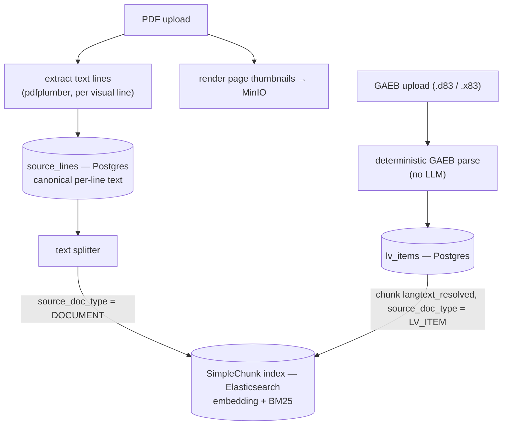
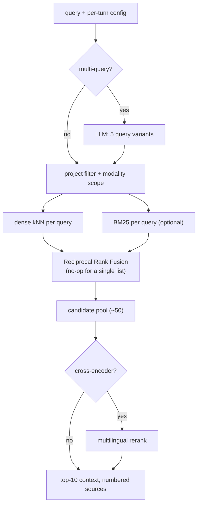
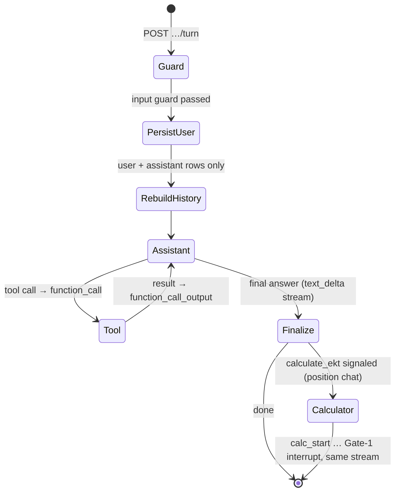
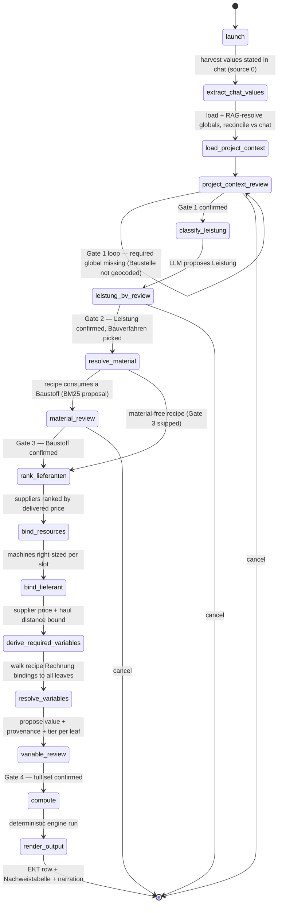
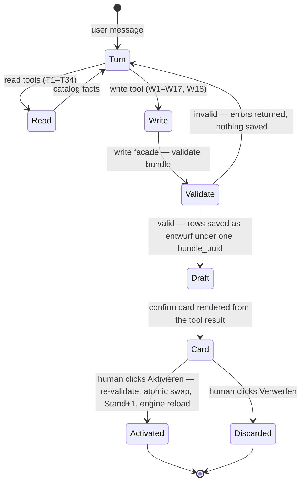
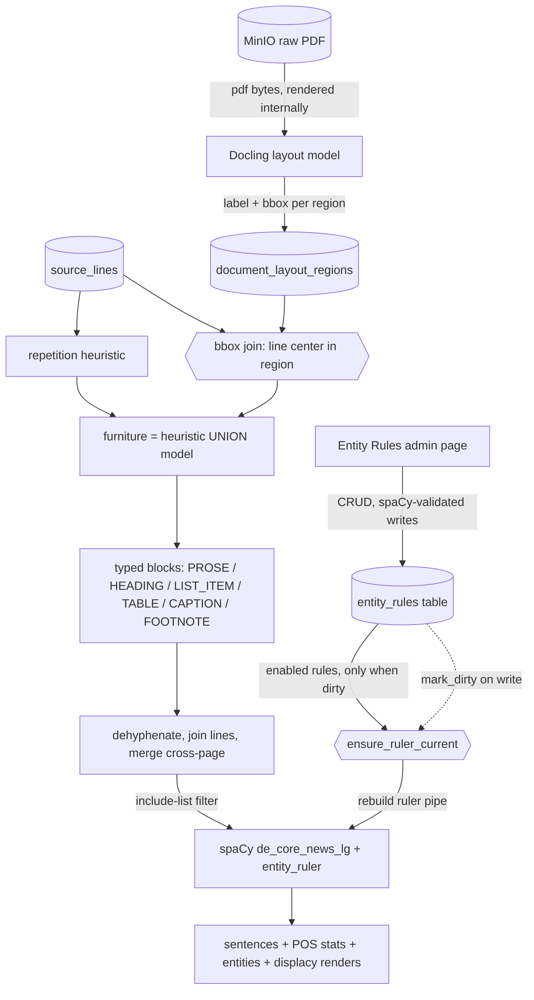

# AI Architecture

How the system uses LLMs: the ingestion and retrieval pipelines, the two stateful agents (Project
Chat and the EKT Calculation Agent), the Katalog Chat agent that maintains the reference data, and
the prompt/model infrastructure underneath them.

The governing design rule: **the LLM judges, deterministic code computes.** LLMs classify
positions, segment and extract text, and decide which tool to call; every euro and every quantity
is produced by `Decimal` arithmetic over cataloged formulas, and every resolved value carries
provenance (source, confidence, evidence). System processes, stores, and the data model are in
`APPLICATION_ARCHITECTURE.md`; domain terms in `GLOSSARY.md`.

## Ingestion Pipeline

Ingestion runs in the worker (job mechanics in `APPLICATION_ARCHITECTURE.md`). Two input paths:

- **Every PDF** gets the common stage: per-line text extraction into `source_lines` (the canonical
  text — the search index is fully rebuildable from it), page thumbnails to MinIO, and simple
  chunking into embedded `DOCUMENT` chunks. This includes the LV print-layout PDF, which is
  treated as prose.
- **LV items come exclusively from GAEB files.** A `.d83` (fixed-format CP850 records) or `.x83`
  (GAEB DA XML) upload is the project's LV document by definition and parses deterministically —
  no LLM. The parse copies Hinweistexte onto the priced positions in their scope, resolves "wie in
  voriger Position" back-references into `langtext_resolved`, and links the OZ hierarchy (`level`,
  `parent_oz`, `prev_oz`/`next_oz`). Items are chunked into `LV_ITEM` chunks from
  `langtext_resolved || langtext`, carrying denormalized `oz` and `stl_nr`.
- **Uploading a GAEB file supersedes the project's LV**: the previous LV document is deleted first
  (Postgres cascade for items, Elasticsearch archive for chunks), preserving the one-LV-document
  invariant. Re-ingestion in general archives a source's prior chunks to the `_archive` index with
  an `archived_at` stamp instead of overwriting; Postgres rows upsert on natural keys.
- An earlier LLM-based parse of LV **PDFs** (segmentation by line spans, verbatim slicing by code)
  is retired from the pipeline; it survives as a standalone harness
  (`python -m scripts.run_lv_extraction`) for experimentation.

A second, LangChain-managed index (`idx-langchain-roadbuilders`) is populated in parallel and
serves as an alternative chunking/embedding path inspectable per document in the UI.

## Retrieval

Retrieval is always project-scoped and configured per turn from the UI (modality, multi-query,
BM25, rerank). Pool sizes come from settings: 5 query variants, ~50-candidate pool, top 10 final.

- **Simple modality** searches `DOCUMENT` chunks only — every document's prose chunks, including
  the LV PDF's own.
- **Plus modality** represents the LV structurally: `LV_ITEM` chunks plus the `DOCUMENT` chunks of
  everything *except* the LV document (excluded so LV content isn't counted twice). Building the
  filter resolves the project's LV document UUID first. If a project has no LV document, Plus
  falls back to Simple instead of failing.
- RRF fires whenever more than one ranked list exists (multi-query or BM25); the cross-encoder is
  the only post-retrieval stage. HyDE was evaluated and rejected: for legally binding tender text,
  hypothetical documents pull semantically-similar-but-irrelevant material into the context.

## Project Chat Agent

Persistent, project-scoped conversations. One turn = `POST /conversations/{id}/turn`, streamed
back as SSE.

The turn pipeline: boundary input guard → persist the user message → rebuild history (only user
and assistant rows are replayed; tool traffic is persisted for display but re-derived fresh each
turn) → a LangChain `create_agent` ReAct loop over a streaming OpenRouter model → persist the
assistant text. Tool calls and results stream as typed SSE events and persist as
`function_call` / `function_call_output` message rows the UI renders (LV tables, citation panels,
maps).

The tool set:

| Tool | Does |
| --- | --- |
| `get_project_context` | Semantic RAG over all project documents; returns numbered evidence. |
| `get_lv_context` | Semantic RAG restricted to LV positions. |
| `get_lv_all` | Every LV position (OZ, Kurztext, Menge, Einheit). |
| `get_lv_single_item` | One position by exact OZ. |
| `get_lv_group_items` | All positions under a section OZ. |
| `aggregate_lv_items` | Quantity aggregation over a free-text predicate: an LLM judges which positions match, Python sums the Mengen (grouped by Einheit; Bedarfs-/Eventualpositionen split out). |
| `render_map` | Geocode an address, render a static map PNG to storage, display inline. |
| `calculate_ekt` | Position chat only: a pure control signal that hands the stream to the calculator. Not persisted, not rendered. |

Citations: retrieval tools feed the model a numbered evidence block and the model grounds its
answer with `[n]` markers. The agent offsets source numbers across multiple retrieval calls within
a turn so `[n]` stays unique; the full retrieval trace (including thumbnails) rides the tool-result
event for the UI's citation panel.

**Position chat** is the same agent bound to one LV position (its Kurztext/Langtext/Menge as
permanent context). When the Kalkulator asks for a calculation, the agent emits `calculate_ekt`;
the router swallows the signal and chains `CalculatorRunService.start` into the same SSE response —
text, `calc_start`, calculator reasoning, and the first interrupt arrive as one stream.

**The Dispatcher** is the same machinery minus state: a single-shot command-bar loop (no history,
nothing persisted, capped at 8 tool turns) whose tools open UI views — projects, prompts, execution
log, usage log, ingest console.

## EKT Calculation Agent

Turns one LV position into an auditable EKT. Output: an **EKT row** (Einheits- and Gesamtpreis
with a cost line per Vorgang and Kostenart), the **Nachweistabelle** (every variable touched —
value, unit, source, evidence, and for formulas the expression and its inputs: the full derivation
tree), and a short narration. Rendering the result as a VHB Formblatt 223 row is a planned
enhancement — the cost lines keep the engine's six Kostenarten today.

### The engine underneath

The deterministic `kalkulation_v2` engine owns a four-level catalog spine — **Leistung** (the
what; a leaf) fulfilled by a selected **Bauverfahren** (the recipe: ordered **Vorgänge**, each
binding an **Ausführungsart** equipment slot) — plus the variable layer: each Vorgang carries a
**Rechnung** that *instantiates* ~16 parameterized base formulas (binding their parameters to
`kontext`/`stammdaten`/`baustoff`/sibling-instance sources), and those bound variables resolve
through per-variable cascades (Langtext → RAG → HITL → Stammdaten → Konstante). The resolver checks
already-supplied values first — that is the seam: the graph fills judgment values
(`LANGTEXT`/`RAG`/`HITL`) into the context, and the engine computes the rest (`STAMMDATEN`/`KONSTANTE`,
and the Rechnung's formula instances) as pure
`Decimal` functions with cycle detection. All catalog content lives in the DB-backed Katalog
(loaded at startup, reloaded on activation); adding a Leistung or recipe is catalog data entry —
the graph topology never changes.

### The graph and its four gates

A LangGraph state machine, checkpointed per conversation (`AsyncPostgresSaver` keyed by the
conversation UUID), so every gate pause survives across HTTP requests. Human decisions are real
`interrupt()`s resumed with `Command(resume=…)`; the UI renders each gate as a structured form,
not free text.

- **Gate 1 — project context.** Project-scoped globals (Baustelle, Deponie, strip dimensions,
  Fräsgut class) are loaded from their SCD-2 store, RAG-resolved where unset, and reconciled
  against values stated in chat (confirm / override / conflict per variable). Required globals are
  enforced: the gate loops until the Baustelle geocodes or the user cancels. Confirmed overrides
  persist as new context versions — the next position in the project inherits them.
- **Gate 2 — method.** The classification LLM proposes the Leistung; the Kalkulator confirms or
  corrects it and picks the Bauverfahren from the mapping's ordered candidates. This precedes
  variable work because the worklist is derived from the chosen recipe.
- **Gate 3 — material.** For recipes that consume a graded Baustoff, a BM25 matcher grounds the
  Langtext's norm designation to a catalog code — it can only return cataloged codes. High-scoring
  matches auto-apply; otherwise the top hit and alternates are surfaced for confirmation.
  Material-free recipes skip this gate.
- **Gate 4 — variables.** Every resolution leaf the recipe's Rechnung binds is proposed with value,
  provenance, and confidence: extracted inputs (chat/Langtext/RAG/default), rates, and master
  data. The review is tiered — low-confidence and high-stakes variables are surfaced for explicit
  decision; confident extractions, rates, and Stammdaten are pre-accepted in a collapsed tier,
  still overridable. The same form carries machine-per-slot and supplier overrides. Submit
  confirms the full set; overrides are captured to the corrections log and can be marked as
  ground truth (see `AI_EVALUATION.md`).

### Resolution precedence

Per variable: (0) values the Kalkulator already stated in chat are harvested up front and pinned —
no search runs for them; (1) Langtext extraction; (2) RAG over the project corpus (Plus modality,
multi-query, BM25, rerank); (3) a flagged Konstante default where the catalog defines one. The
extraction LLM copies values verbatim with an evidence quote — it never computes. A value that
cannot be found surfaces at Gate 4 as an open decision, never a silent guess.

### Resource binding

- **Machines** — candidates come from the Katalog fleet by Ausführungsart; the default is
  right-sized: the smallest machine that clears the job within the configured target hours. A
  bound machine's rates and per-Betriebsart productivity feed the Maschine cost lines and the
  `arbeitszeit` instance (the labour-hours basis) and stay overridable at Gate 4.
- **Suppliers** — after material confirmation, Lieferanten with a valid ex-works price and known
  coordinates are pre-filtered by great-circle radius (default 100 km), route distances to the
  Baustelle are computed in one route-matrix call, corrected by an HGV detour factor, and offers
  are ranked by delivered price (Werkspreis + €/t·km transport). The chosen supplier's price
  overrides the material's base price through the standard master-data bridge, and the haul
  distance feeds the Antransport (F_TRANSPORT) instances. Switching supplier at Gate 4 re-applies
  from the ranked list without re-routing.

## Katalog Chat Agent

The maintenance agent for the reference data. Same ReAct/streaming machinery as project chat, with
a seeded, versioned system prompt (the Katalog-Handbuch) and three tool families: **34 read tools**
(browse/search every entity, base-formula explanation with LaTeX + declared parameters, the
`ontologie_lookup` "where does this input live" tool, where-used impact analysis, SCD-2 history,
price validity), **17 write tools** (draft new/changed base Formeln, Variablen, Baustoffe,
Lieferanten, Preise, Maschinen, taxonomy entries, Leistung–Bauverfahren mappings), and the
**recipe compiler** (W18), which drafts one coherent bundle spanning any subset of entities.

The human-in-the-loop boundary is structural, not prompt-based: write tools go through a facade
that exposes validate, save-draft, and discard — activation is deliberately absent from the
agent's reach and exists only as an API endpoint behind the authenticated routes. Validation is a
pure rule set over the draft plus the active catalog: a base formula must parse, close over its
declared parameter signature, and carry mandatory prose (on the formula and each parameter); every
Vorgang Rechnung must be evaluable — its instances bind known, producible variables with
**dimension-compatible units** (a scalable cm→m is fine; a dimension change is a Mengengerüst
formula's job, not a binding); a candidate formula **structurally isomorphic** to an existing base
formula is rejected ("instantiate, don't mint"); every variable carries prose; every code reference
resolves; prices name known parties with ordered validity; same-key rows are reported as updates.
Activation re-validates against the *current* catalog, activates atomically, closes superseded
price validity windows, bumps the global Stand, and reloads the running engine.

Guard rules from the Handbuch (the load-bearing ones): never invent codes — search first (the
`ontologie_lookup` tool answers "where does this input live"), answer only from tool results; never
self-activate; never invent a DSL function — a missing function is an engineering request, not a
formula; **instantiate base formulas, don't mint** — a new base formula only for a genuinely new
shape; rates belong in Stammdaten variables; the Leistung's unit fixes the booked geometry the
Rechnung binds against.

The recipe compiler composes with the same flow: it looks up the ontology, normalizes a whole-recipe
bundle of base-formula instantiations, runs the full rule set (incl. structural dedup + unit
compatibility), enforces a coverage contract (every code defined or referenced must be justified as
either reuse or new), and adds non-blocking warnings — BM25 duplicate probes and geometry-dependency
checks — before saving one draft bundle for the same confirm card.

## Prompt Management

Every persistent prompt is an immutable `PromptVersion` row pinning system text, model, and
sampling parameters per `prompt_type`; creating a new version never disturbs the old, and call
sites load the latest at runtime. Prompts are seeded from `.prompt` files (YAML frontmatter +
system text) — currently twelve types: `project_chat`, `dispatcher`, `conversation_name`,
`aggregate_lv_membership`, `multi_question_generator`, `project_context_resolve`, `katalog_handbuch`
(the Katalog-Chat system prompt), the calculator's four (`ekt_leistung_classify`, `ekt_chat_values`,
`ekt_langtext_extract`, `ekt_output_narrate`), and `lv_extraction` (the retired PDF-parse harness).
Seeding appends a new version per run by design — edit the file, re-seed, and the new version is live.

Structured outputs are schema-in-code: a registry maps a `prompt_type` to a Pydantic model, and
the LLM client validates every response at the boundary, so malformed output raises instead of
propagating. Adding a prompt type touches the backend enum (single source of truth), a seed file,
the load site, and the CHECK constraints that mirror the enum in `prompt_versions` and
`conversations`.

The calculator takes its model from settings rather than a prompt row (`CALCULATOR_MODEL`, plus
reasoning effort and a full mock mode for offline runs). The Katalog chat, by contrast, now loads
its system prompt AND model from the seeded `katalog_handbuch` version (the frontmatter owns the
model choice), so editing that prompt in the editor changes both — and the recipe-compiler eval
measures the live version.

## Document Reflow and NLP Analysis

The NLP analysis modal (sidebar → Werkzeuge) turns a Baubeschreibung's raw `source_lines` into
linguistically usable text and lets you inspect every intermediate step: reflowed blocks vs
original lines, sentence segmentation with displacy renders, POS distribution, and a domain-aware
named-entity view.

`source_lines` are visual layout lines (`pdftotext -bbox-layout`), not linguistic units: German
justification hyphenates words across lines, letterheads repeat on every page, sentences span
pages, and tables shred into cell fragments. The reflow pipeline fixes this with a hybrid of the
existing poppler extraction (authoritative *text*, AcroForm-capable) and the Docling layout model
(*structure*), validated in the layout spike (`nlp-playground/layout-spike/`):

Key decisions (full rationale in `openspec/changes/nlp-analysis-modal/design.md`):

- **Furniture is the union** of a repetition heuristic (digit-run-normalized text + y-bucket on
  ≥50% of pages) and Docling `page_header`/`page_footer` regions — the spike showed the heuristic
  wins on repeated letterheads, the model wins on roman-numeral front matter.
- **German dehyphenation**: a line-end hyphen joins the next line dropping the hyphen when it
  starts lowercase (`gekom-`/`menen`), keeping it when uppercase (`SRT-`/`Pendel`). Cross-page
  merges require no lowercase test — German capitalizes nouns mid-sentence.
- **Block-type inclusion is per-request config** (`include_blocks`, default PROSE + HEADING +
  LIST_ITEM); tables are excluded by default so cell fragments never reach the sentence splitter,
  but can be toggled on in the modal to observe the degradation.
- **Models load lazily** (spaCy and Docling are module singletons, never loaded at API boot) and
  both expensive artifacts are cached: layout regions per document + Docling version, dep-SVGs
  by content hash including the spaCy model version.
- Every block records its `line_id` range, so any sentence, token, or entity resolves back to
  page + bbox in the original PDF.
- **Domain NER via a DB-backed EntityRuler.** The stock `de_core_news_lg` NER (PER/LOC/ORG/MISC,
  trained on news) is near-blind on Baubeschreibung vocabulary — `Asphaltbeton AC` guesses LOC,
  `Bauablaufplan` nothing. An `entity_ruler` pipe, compiled from the `entity_rules` table (label +
  spaCy pattern JSONB + optional `pattern_id`, seeded once from a 240-rule authored fixture across
  14 domain labels), runs after the stock `ner` with `overwrite_ents=True` so domain rules win over
  generic mispredictions. Rules are CRUD-managed live from the **Entity Rules** admin page; every
  write is validated against a scratch spaCy pipeline before it persists, and flips an in-process
  dirty flag (the API is single-process — no version table needed) so the next `analyze`/`render`
  rebuilds the pipe from the current enabled set. No restart, no redeploy to change a pattern.
- **Entities are computed in the same pass** as sentences and POS: `AnalyzeResponse.entities`
  groups every hit by label with per-occurrence text, sentence, and `pattern_id` provenance. The
  modal's Entities tab ranks labels by frequency and marks each occurrence as a rule hit (its
  `pattern_id`) or a stock-model guess (none) — making wrongly-predicted entities visible rather
  than silently "fixed". The per-sentence `ent` displacy render uses manual mode, so it reflects
  the ruler automatically. Generating patterns from Katalog rows is a natural, separately-scoped
  follow-up.

## Model Access, Logging, and Tracing

All model traffic — chat completions, embeddings, rerank — goes through one OpenRouter transport
layer. The LLM client streams typed events (text deltas, tool calls, done), enforces structured
output, and distinguishes refusals and truncation as typed errors. Embeddings pass through an
optional Postgres cache keyed by SHA-256 of model, dimension, and text.

Every call is recorded twice: an `openrouter_usage` row (tokens, cost, operation, attribution) and
a `prompt_execution_log` row (full request and response, latency, finish reason). Agent runs open
an OTLP flow span carrying the conversation UUID as the session id, so a conversation's turns —
graph nodes, LLM calls, retrieval calls — group as nested spans in Phoenix.

## Future Enhancements

- **Formblatt 223 rendering** — mapping the six engine Kostenarten and the `*_stunden` labour
  basis into the four 223 columns plus Zeitansatz, per position.
- **Zuschläge (VHB 221/222)** — Baustellengemeinkosten, Allgemeine Geschäftskosten, Wagnis und
  Gewinn on top of the EKT to reach the full Einheitspreis.
- **Machine mobilization costs** — mob/demob rates exist in the machine property bags but no cost
  line consumes them yet; wiring them in would let cost-optimal right-sizing emerge.
- **Growth of the Katalog** — more Leistungen, recipes, and machine/material coverage; the
  intended feedback loop from Nachkalkulation into rates and prices.
