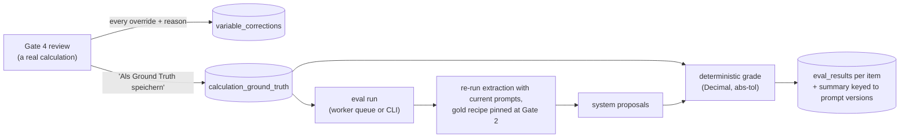

# AI Evaluation

The failure modes of the LLM-driven components, the evaluation architecture that measures them, and
how to reproduce the measurements.

The design stance: the deterministic calculation engine is trusted (its arithmetic is pure
`Decimal` over cataloged formulas, pinned by fixtures), so evaluation targets the **LLM judgment
sites** — classification, extraction, harvesting. All grading is deterministic comparison
(`Decimal` with a configurable absolute tolerance); there is no LLM judge anywhere in the current
system.

## Failure Modes

Each way the system can be wrong, mapped to the measurement that detects it:

| Failure mode | Detected by |
| --- | --- |
| Wrong Leistung classification for a position | `classification_accuracy` (calculator_gold) |
| Wrong default Bauverfahren for the classified Leistung | `bauverfahren_accuracy` (calculator_gold) |
| A findable value not found (extraction miss) | `found_recall` (calculator_gold) |
| A found value that is wrong | `value_accuracy` (calculator_gold) |
| A value found in the wrong source | `provenance_accuracy` (calculator_gold) |
| Chat-stated values misread, missed, or invented | `precision` / `recall` / `spurious` (chat_values) |
| Recipe compiler minting duplicates instead of reusing the catalog | reuse rate + duplicate warnings (rezept_compiler, human-graded) |
| Retrieval returning wrong or missing context | not yet measured — ground truth exists, eval kinds reserved |
| Chat answers unfaithful to sources; narration contradicting the computed result | not yet measured |

The corrections log covers the residual: every Gate-4 override is recorded with a reason, and the
reason taxonomy separates model errors from things no extraction metric should count (see Golden
Data).

## Evaluation Architecture

Two halves: **in-product capture** builds gold data as a byproduct of real review work, and
**offline grading** re-runs the LLM sites with the current prompts and scores them against that
gold.



- **Capture** happens when the resume of a Gate-4 review arrives, before compute runs: every
  overridden variable writes a `variable_corrections` row (proposal vs final value, reason,
  note) — always. If the Kalkulator ticked "Als Ground Truth speichern", the endorsed state — the
  confirmed Leistung/Bauverfahren and every reviewed value — upserts into
  `calculation_ground_truth` for that position.
- **Grading** re-drives the real calculator graph per gold position up to Gate 2, records the
  system's own classification, then resumes with the *gold* recipe so the variable worklist is the
  correct one (extraction quality is decoupled from classification, which is scored separately).
  Material recipes accept the BM25 proposal at Gate 3. The run stops at the variable gate and
  grades the proposals; **the price compute never runs** — only the LLM sites are under test
  (`ekt_leistung_classify`, `ekt_chat_values`, `ekt_langtext_extract`).
- **The queue**: an eval run is an `eval_runs` row claimed by the worker's second
  competing-consumer loop with the same lease/heartbeat/retry mechanics as ingestion. Progress
  goes to `eval_run_events` (the UI's live feed), per-item detail to `eval_results`, and the
  summary metrics onto the run row. Only `calculator_gold` and `chat_values` kinds are accepted;
  the two RAG kinds are enum-reserved and rejected at enqueue.
- **Prompt-version pinning**: every run records the exact prompt versions it evaluated
  (`eval_runs.prompt_versions`). That is the regression key — edit a prompt, re-run, and
  before/after is a diff between two summaries.
- The CLIs and the worker share the same runner code; the CLI just prints progress and writes
  JSONL + summary files instead of DB rows.

## What Is Measured

**calculator_gold** — headline metrics cover only `eingabe` leaves (the model-extracted ones);
rates and Stammdaten are catalog lookups and excluded. Values compare as `Decimal` within
`abs_tol` (default exact).

| Metric | Definition |
| --- | --- |
| `classification_accuracy` | re-run's own Leistung choice == gold, per position |
| `bauverfahren_accuracy` | re-run's default Bauverfahren == gold, over positions whose gold pins one |
| `found_recall` | of gold values that should be found, fraction the re-run produced at all |
| `value_accuracy` | of gold values that should be found, fraction matching within tolerance |
| `provenance_accuracy` | fraction with the right source, over assessable leaves (human-overridden gold is excluded — its source is `hitl`, which extraction can never produce) |

**chat_values** — set-shaped grading of `(name, value)` assignments harvested from authored
transcripts:

| Metric | Definition |
| --- | --- |
| `precision` / `recall` / `f1` | a true positive needs the right variable name *and* value |
| `name_recall` | gold names emitted at all, regardless of value |
| `value_accuracy` | of emitted gold names, fraction with the right value |
| `spurious` | emitted names not in gold — invented assignments |
| `exact_fixtures` | fixtures with everything correct and nothing spurious |

**rezept_compiler** — a separate harness (not in the run queue) that drives the production Katalog
chat agent through four real-LV recipe briefs (W18, repair budget of 3 attempts). Measured per
recipe: valid bundle produced and repair iterations used; **reuse rate**
(reused ÷ (reused + minted)) plus hits against an expected-reuse list; and a **rolled-back
activation** — the draft bundle is activated inside a transaction, a synthetic position is
calculated against an EP plausibility band, then everything rolls back. Results are Markdown
reports under `eval/rezept_compiler/`, graded by a human; there are no automated pass/fail
thresholds.

## Golden Data

- **`calculation_ground_truth`** — one row per `(project, position)`, upserted: the endorsed
  Leistung/Bauverfahren and `gold_variables` (per name: value, unit, kind, source, whether a human
  overrode it). Two staleness mechanisms guard it: rows whose recipe no longer exists in the
  Katalog are skipped (and counted) rather than crashing a run, and gold is keyed by variable
  name — recipe or catalog changes can alter a position's worklist, so gold should be re-confirmed
  after catalog changes.
- **`variable_corrections`** — append-only, one row per overridden leaf with the model's proposal,
  the human's final value, and a reason. The taxonomy is what keeps metrics honest: `falscher_wert`,
  `falsche_quelle`, and `einheit` are model errors; `kontext_fehlt` is a data gap (the value was
  not in the documents); `kalkulator_ermessen` is expert judgment, not an error. The eval UI's
  corrections tab aggregates by variable and reason.
- **Chat fixtures** — JSONL, one fixture per line: an id, a transcript, and gold `{name: value}`
  assignments in each variable's own unit (the extractor reads verbatim and never converts). The
  set includes a control fixture stating no values, so invented assignments surface as `spurious`.
- **`rag_ground_truth`** — curated per-project reference questions with a gold answer and
  page-level document references, typed (lookup, aggregation, multi-hop, constraint surfacing,
  cross-document conditional) and categorized by persona (Kalkulator / Bauleiter). Managed in the
  eval UI; a repo-level set (`eval/questions.csv` + `eval/truth.json`) was generated with
  LLM assistance and human review. This is the prepared input for the reserved RAG eval kinds.

## Running Evals

**From the UI** — the eval workspace (`/p/{project}/eval`) has tabs for runs, calculation gold,
RAG questions, and corrections. Enqueue a run from the Runs tab; progress events stream in and the
per-item drill-down opens from the run row. The API surface is `POST /eval-runs` +
`GET /eval-runs/{id}/events|results`.

**From the CLI** (same graders, file output to `eval/calculator/results/`, git-ignored):

```bash
# Calculator extraction vs captured gold (needs Postgres + Elasticsearch + OpenRouter,
# project ingested; refuses to run in calculator mock mode):
PYTHONPATH=server uv run python -m scripts.eval_calculator.run \
  --project <project_uuid> [--abs-tol 0] [--limit N]

# Chat-value extraction vs authored fixtures (needs only Postgres + OpenRouter):
PYTHONPATH=server uv run python -m scripts.eval_calculator.run_chat \
  --dataset eval/calculator/chat_values/example.jsonl [--abs-tol 0]

# Recipe compiler (drives the live Katalog chat agent; human-graded report):
PYTHONPATH=server uv run python -m scripts.eval_rezept_compiler [--verwerfen]
```

Every summary prints and stores the prompt versions it ran against — compare summaries across
prompt edits to see regressions.

## Current Baselines

From live worker-queue runs on 2026-07-06. The sample sizes are smoke-scale — they prove the
pipeline end to end; they are not yet statistically meaningful. Growing the gold set
(~15–30 positions across Leistung types, ~10–20 chat fixtures) is the next curation step.

| calculator_gold (2 positions, 6 expected values) | |
| --- | --- |
| `classification_accuracy` | 1.00 |
| `bauverfahren_accuracy` | 1.00 |
| `found_recall` | 1.00 |
| `value_accuracy` | 0.83 |
| `provenance_accuracy` | 0.67 |

| chat_values (3 fixtures, 5 gold assignments) | |
| --- | --- |
| `precision` / `recall` / `f1` | 0.80 / 0.80 / 0.80 |
| `name_recall` | 0.80 |
| `value_accuracy` | 1.00 |
| `spurious` | 1 |
| `exact_fixtures` | 1 of 3 |

The rezept_compiler harness has an authoritative graded run in
`eval/rezept_compiler/EVAL_REPORT.md`: all four recipes produced valid, activatable bundles within
the repair budget.

## Coverage Gaps

- **RAG retrieval and answer quality** — the ground truth exists (`rag_ground_truth`,
  `eval/truth.json` with page-level references) but the `rag_retrieval` / `rag_answers` run kinds
  are reserved and rejected at enqueue. Planned: recall@k / MRR / nDCG for retrieval; answer
  correctness, faithfulness, and citation accuracy for chat.
- **Narration faithfulness** — `ekt_output_narrate` prose is ungraded; it could contradict the
  computed EKT row. Needs a groundedness judge — this would be the system's first LLM-judged
  metric.
- **Dispatcher / tool-trajectory checks** — did the agent route to the right view or call the
  right tool; rule-based, not built.
- **Confidence calibration** — extraction confidences are captured per value but not yet analysed
  against correctness; the result would tune the Gate-4 review threshold (0.75).
- **Regression gating** — runs are keyed to prompt versions, but nothing automatically re-runs the
  graders when a calculator prompt changes; the comparison is manual today.
