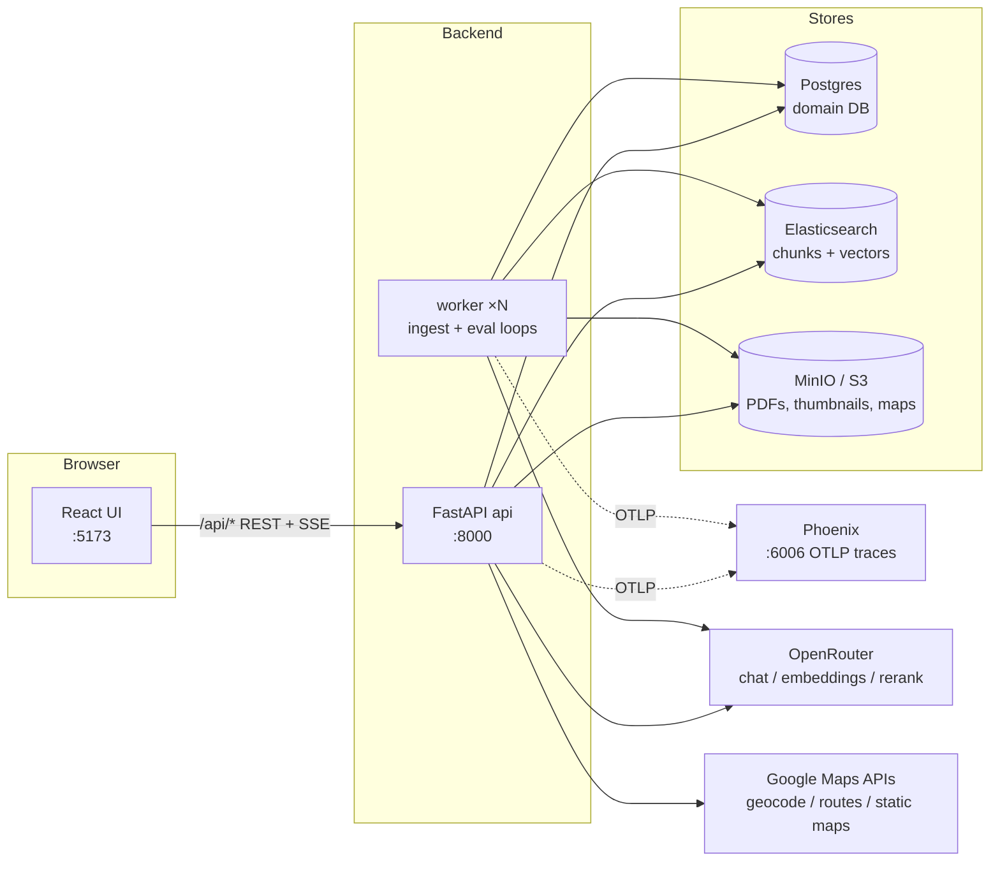
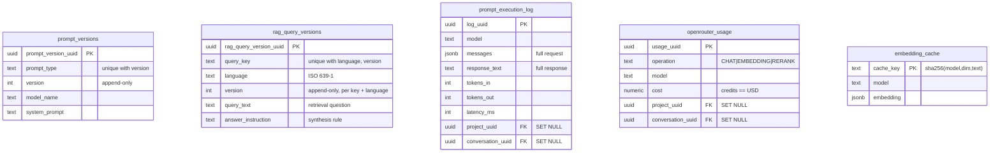
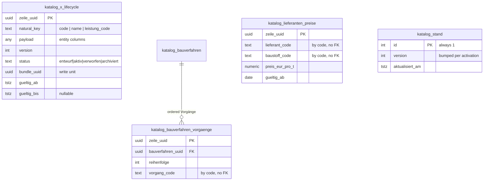

# Application Architecture

How the system is put together: processes, layers, the data model, and the conventions that hold
them together. The AI internals — ingestion pipelines, retrieval, the agents, prompt management —
are in `AI_ARCHITECTURE.md`. German domain terms are defined in `GLOSSARY.md`.

## System Overview



| Component         | Role                                                                                                                                                                            |
| ----------------- | ------------------------------------------------------------------------------------------------------------------------------------------------------------------------------- |
| **UI**            | Vite + React 19 SPA. Talks only to the API via `/api/*` (REST + Server-Sent Events).                                                                                            |
| **API**           | FastAPI. Thin HTTP surface over the service layer; streams chat turns and ingest status over SSE.                                                                               |
| **Worker**        | One asyncio process running two competing-consumer loops (document ingestion, eval runs). Scaled horizontally; Postgres allocates jobs via `SKIP LOCKED`.                       |
| **Postgres**      | Canonical relational data. Three databases on one host: the domain DB, `{db}_auth` (provisioned for the planned auth stack, currently unused), `{db}_test` (integration tests). |
| **Elasticsearch** | Two indexes: the SimpleChunk index (`roadbuilders_text`, BM25 + kNN vectors) and a LangChain-managed index. Fully rebuildable from Postgres.                                    |
| **MinIO / S3**    | Raw uploaded PDFs, per-page thumbnails, rendered map PNGs. Key prefixes `raw/`, `thumbnail/`, `map/`.                                                                           |
| **Phoenix**       | Local OTLP trace collector and UI for every LLM call and agent flow.                                                                                                            |
| **OpenRouter**    | The single LLM egress: chat completions, embeddings, rerank.                                                                                                                    |
| **Google Maps**   | Geocoding, route matrices, and static map rendering for Baustelle/Deponie/Lieferant logistics.                                                                                  |

## Repository Layout

```
server/            Python 3.12 backend (uv-managed, deps in root pyproject.toml)
  api/             FastAPI app: main.py, deps.py, routes/ (one file per resource)
  shared/          Logic shared by API and worker
    clients/       Infrastructure clients: llm, embeddings, rerank, search, storage, maps, openrouter
    db/            SQLAlchemy Core: tables/, shared MetaData, engine, Unit of Work
    models/        Pydantic: domain models, API schemas, LLM output schemas, enums
    repositories/  Core-backed repositories, constructed with an AsyncConnection
    services/      Business logic (see inventory below)
  worker/          The worker process harness (main.py, eval_loop.py)
  scripts/         Bootstrap, seeding, schema export, dev/eval CLIs
ui/                Vite + React 19 + TypeScript SPA
tests/             unit/ and integration/ (pytest, uv run pytest)
eval/              Eval fixtures and generated reports (not application code)
sql/               Ad-hoc SQL mounted into the Postgres container
data/              Bind-mounted store volumes (postgres, elasticsearch, minio, phoenix)
```

## Backend (server/)

### Layered design

A request travels route → service → repository → table:

- **Routes** (`api/routes/`, one file per resource) are thin: parse/validate the DTO, resolve
  dependencies, delegate to a service, shape the response. No business logic.
- **Services** (`shared/services/`) own all business logic and transaction boundaries. They are
  shared verbatim between the API and the worker.
- **Repositories** (`shared/repositories/`) translate between SQLAlchemy Core rows and Pydantic
  domain models. Every repository is constructed with an `AsyncConnection` — never an engine — so
  repositories composed into one Unit of Work share a transaction.
- **Tables** (`shared/db/tables/`) are SQLAlchemy Core `Table` objects on one shared `MetaData`
  with a deterministic naming convention for indexes and constraints. No ORM: no
  `DeclarativeBase`, no `Session`, no mapped classes.

Three Pydantic model families live in `shared/models/`, kept deliberately separate:

- **Domain models** — canonical in-memory shapes; what repositories return. Each aggregate has a
  `New{Entity}` create-model and an `{Entity}` read-model.
- **API schemas** — request/response DTOs, a separate type family that may expose narrower fields.
  These are the source for the generated TypeScript types.
- **LLM output schemas** (`models/llm_output_schemas/`) — structured-output contracts for LLM
  calls, mapped to prompt types in `clients/llm/prompt_registry.py`. Responses are validated at
  the client boundary, so a malformed LLM response raises instead of flowing downstream.

`db/` knows nothing about Pydantic; `models/` knows nothing about SQLAlchemy. Repositories are the
only translation point. User chat input passes a boundary guard
(`services/security/input_guard.py`) before reaching any agent.

### Unit of Work and transactions

`shared/db/unit_of_work.py` defines a `UnitOfWork` that owns one `AsyncConnection` and constructs
~20 repositories sharing it. The `unit_of_work(engine)` context manager wraps `engine.begin()`:
clean exit commits, an escaping exception rolls back. Callers never commit or roll back manually.

The API exposes this as two dependency shapes in `api/deps.py`: `get_connection` (plain connection,
no transaction — reads) and `get_uow` (transactional Unit of Work — writes). Multi-repository
writes are therefore atomic by construction.

One write path deliberately bypasses the Unit of Work: `DatabaseUsageSink` persists each
OpenRouter usage row in its own short transaction on its own engine. The API call already incurred
real spend, so the cost record must survive even when the surrounding business transaction rolls
back.

### API surface

All logic sits behind these route groups (SSE = streaming endpoint):

| Group                                                          | Endpoints                                                                                                                                                                                                       |
| -------------------------------------------------------------- | --------------------------------------------------------------------------------------------------------------------------------------------------------------------------------------------------------------- |
| `/health`                                                      | Liveness and DB connectivity checks.                                                                                                                                                                            |
| `/projects`                                                    | Project/document CRUD, LV positions and hybrid LV search, document upload, (re-)ingest queueing, **SSE** per-project ingest status stream, thumbnail/map proxies from storage, document detail/chunks/activity. |
| `/projects/.../context`                                        | Project-context globals: read, per-variable history, HITL override, clear, RAG resolve, geocode, static and route map PNGs.                                                                                     |
| `/conversations`                                               | Conversation CRUD, message history, per-conversation cost, auto-naming, and the central **SSE** `/turn` endpoint that streams a chat turn (project chat, position chat, Katalog chat, calculator resume).       |
| `/dispatch`                                                    | **SSE** single-shot, stateless command-bar routing.                                                                                                                                                             |
| `/projects/.../calculations`                                   | Creates the position-chat conversation for an LV position (the calculation itself streams through `/turn`).                                                                                                     |
| `/katalog`                                                     | Catalog reads per entity, bundle validate/save/activate/discard, catalog reload.                                                                                                                                |
| `/eval-runs`                                                   | Enqueue eval runs, list runs, live progress events, per-item results.                                                                                                                                           |
| `/projects/.../ground-truth`, `/projects/.../rag-ground-truth` | Curated calculation gold and RAG reference questions; Gate-B variable-correction views.                                                                                                                         |
| `/ingest-jobs`                                                 | Ops console: list jobs, requeue, **SSE** granular activity stream.                                                                                                                                              |
| `/prompts`, `/prompt-execution-logs`, `/usage`                 | Prompt Library (append-only versions), full LLM call log, OpenRouter cost log.                                                                                                                                  |
| `/nlp`                                                         | NLP analysis modal: reflowed document text (typed blocks + classified lines), sentence/POS/entity analysis with a block-type include list (by `document_uuid` or ad-hoc `text`), full-text ent render, displacy renders (see AI_ARCHITECTURE.md "Document Reflow and NLP Analysis").  |
| `/entity-rules`, `/ner-flags`                                  | Domain NER: EntityRuler rule CRUD (spaCy-validated); NER error flags — create-with-synchronous-LLM-analysis, list/filter, category summary, resolve/override, re-analyze, delete (see AI_ARCHITECTURE.md "NER Error Investigation").  |

FastAPI serves the generated OpenAPI documentation at `/docs`. CORS is restricted to the Vite dev
origin. Authentication is a development stub: `get_current_user()` returns a fixed administrator
`Principal` for every request (see Future Enhancements).

At startup the API's lifespan builds the long-lived assets on `app.state`: the engine, the storage
and search clients, telemetry sinks, the LLM/embeddings/reranker clients, a psycopg connection
pool for the LangGraph `AsyncPostgresSaver` checkpointer (which persists the calculator's
human-in-the-loop state across requests), and it loads the persisted Katalog into the calculation
engine (`lade_katalog`; re-loadable at runtime via `POST /katalog/neu-laden`).

## Data Model

### Entity overview

The domain DB groups into six clusters:

- **Project / document / ingest** — `projects` → `documents` → `source_lines` (canonical extracted
  text), `thumbnails`, `lv_items`, `lv_texts` (the LV's Vorbemerkungen, Hinweise and Nachtext),
  `ingest_jobs` → `ingest_job_events`, plus the high-frequency
  `ingestion_activity_log` and its archive.
- **Conversation** — `conversations` (discriminated by `prompt_type`; position chats also carry
  `lv_item_uuid` and a `calculation_status`) → `messages` (user / assistant / function_call /
  function_call_output).
- **Katalog** — 13 SCD-2 lifecycle tables plus a Bauverfahren–Vorgang junction, the immutable
  supplier price history, and the singleton `katalog_stand` version row (next section).
- **Eval and gold data** — `eval_runs` → `eval_run_events`, `eval_results`; curated
  `calculation_ground_truth`, `rag_ground_truth`, and the append-only `variable_corrections`.
- **Prompt / usage / observability** — append-only `prompt_versions`, the full-fidelity
  `prompt_execution_log`, `openrouter_usage`, `embedding_cache`.
- **Project-info RAG queries** — append-only `rag_query_versions`, versioned like prompts: one
  row per `(query_key, language, version)`. `query_key` is the `ProjectInfoQuery` enum (each key
  maps to a fixed `projects` header column); `query_text` is the retrieval question and
  `answer_instruction` the synthesis rule. Edited in the RAG Queries view.
- **NLP analysis caches** — `document_layout_regions` (Docling layout output per document and
  model version; PDFs are immutable so inference runs once) and `nlp_render_cache` (displacy
  dep-SVGs keyed by sha256 of spaCy model + version + style + sentence text).
- **Domain NER** — `entity_rules` (EntityRuler patterns: label + spaCy pattern JSONB + optional
  `pattern_id` + enabled) and `ner_flags` (persisted mispredictions: kind, snapshotted span /
  sentence / source text / flag-time entity list, nullable LV-item/document link, plus the one-shot
  LLM analysis — `category`, `category_override`, prose, advisory `suggested_rule`, and provenance
  columns — with an open/resolved status). Both are read for the `ner_fehleranalyse` prompt.
- **Context** — `project_context_values`, the SCD-2 history of project-scoped globals (Baustelle,
  Deponie, strip dimensions, …).

### Postgres ERD

```mermaid
erDiagram
    projects ||--o{ documents : "has"
    projects ||--o{ conversations : "has"
    projects ||--o{ project_context_values : "scopes"
    projects ||--o{ eval_runs : "scopes"
    projects ||--o{ rag_ground_truth : "scopes"
    projects ||--o{ calculation_ground_truth : "scopes"
    projects ||--o{ variable_corrections : "scopes"
    documents ||--o{ source_lines : "extracted into"
    documents ||--o{ thumbnails : "rendered as"
    documents ||--o{ lv_items : "parsed into"
    documents ||--o{ lv_texts : "LV-level texts"
    documents ||--o{ ingest_jobs : "processed by"
    ingest_jobs ||--o{ ingest_job_events : "logs"
    ingest_jobs ||--o{ ingestion_activity_log : "streams"
    conversations ||--o{ messages : "contains"
    lv_items |o--o{ conversations : "position chat (SET NULL)"
    lv_items ||--o| calculation_ground_truth : "gold per position"
    eval_runs ||--o{ eval_run_events : "progress"
    eval_runs ||--o{ eval_results : "per-item results"

    projects {
        uuid project_uuid PK
        text project_name "Massnahme"
        text massnahmenummer "nullable"
        text vergabe_id "Vergabenummer, nullable"
        text bauleistung "nullable"
        text vergabestelle "nullable"
        text location "Baustelle, nullable"
    }
    documents {
        uuid document_uuid PK
        uuid project_uuid FK
        text document_type "LV_DOCUMENT | PROSE_DOCUMENT"
        text file_name
        int number_of_pages
    }
    source_lines {
        uuid source_line_uuid PK
        uuid document_uuid FK
        int line_id "unique per document"
        int page
        float_arr bbox
        text line_text
    }
    thumbnails {
        uuid thumbnail_uuid PK
        uuid document_uuid FK
        int page_number
        text object_key "MinIO identity"
        text bucket
    }
    lv_items {
        uuid lv_item_uuid PK
        uuid document_uuid FK
        text oz "unique per document"
        text kurztext
        text langtext
        text langtext_resolved "nullable"
        numeric menge
        text einheit
        text positionstyp "nullable"
        text parent_oz "OZ linkage, also prev/next/linked"
        uuid_arr source_lines "no FK"
    }
    lv_texts {
        uuid lv_text_uuid PK
        uuid document_uuid FK
        text kind "ADD_TEXT | REMARK"
        text placement "before | after, ADD_TEXT only"
        text parent_oz "REMARK: enclosing LV-Gruppe, null at root"
        int index "ordinal within placement / parent"
        int sequence "document order"
        text heading "nullable"
        text body
    }
    ingest_jobs {
        uuid job_uuid PK
        uuid document_uuid FK
        text status "queued|running|done|failed"
        tstz locked_at "lease"
        text locked_by "worker id"
        int attempts
    }
    conversations {
        uuid conversation_uuid PK
        uuid user_uuid "auth DB, deliberately no FK"
        uuid project_uuid FK "nullable"
        uuid lv_item_uuid FK "nullable, SET NULL"
        text prompt_type
        text calculation_status "nullable"
    }
    messages {
        uuid message_uuid PK
        uuid conversation_uuid FK
        text kind "user|assistant|function_call|function_call_output"
        text content "nullable"
        jsonb arguments "tool calls"
        jsonb data "tool results"
    }
    project_context_values {
        uuid project_context_value_uuid PK
        uuid project_uuid FK
        text variable_name
        int version "SCD-2"
        text wert
        text quelle "rag|hitl|routing"
        bool ist_aktuell "partial unique"
    }
    eval_runs {
        uuid eval_run_uuid PK
        uuid project_uuid FK "nullable"
        text kind "calculator_gold|chat_values|rag_*"
        text status "queued|running|done|failed"
        tstz locked_at "lease"
        jsonb summary
    }
    calculation_ground_truth {
        uuid ground_truth_uuid PK
        uuid project_uuid FK
        uuid lv_item_uuid FK "unique per project"
        text leistung_key
        jsonb gold_variables
    }
    rag_ground_truth {
        uuid rag_ground_truth_uuid PK
        uuid project_uuid FK
        text question
        text gold_answer
        jsonb refs "document_uuid + page"
    }
    variable_corrections {
        uuid correction_uuid PK
        uuid project_uuid FK
        text variable_name
        text proposed_wert
        text final_wert
        text reason "enum, nullable"
    }
```



Standalone (referenced by SET-NULL attribution FKs from `projects`, `documents`, `ingest_jobs`,
and `conversations`, so history outlives deleted parents):



### The Katalog tables

The 13 `katalog_*` entity tables are generated by one table factory
(`db/tables/katalog_lifecycle.py`) and share an SCD-2 shape: a natural key (`code`, `name`, or
`leistung_code`; `katalog_variablen` adds a `gruppe` discriminator), the entity payload, and seven
lifecycle columns — `version`, `status` (`entwurf` / `aktiv` / `verworfen` / `archiviert`),
`bundle_uuid`, `benutzer`, `gueltig_ab`, `gueltig_bis`, `erstellt_am`. Edits insert a new version;
rows are never mutated. Two constraints enforce the lifecycle: `UNIQUE(key, version)` and a partial
unique index allowing one `aktiv` row per key.



Lifecycle instantiations: `leistungen`, `bauverfahren`, `vorgaenge`, `ausfuehrungsarten`,
`betriebskategorien`, `betriebsarten`, `formeln`, `variablen`, `globale_variablen`, `baustoffe`,
`lieferanten`, `maschinen`, `leistung_bauverfahren`. Cross-katalog references are by code, not
FK — referential integrity is enforced by the bundle validator at write time, which keeps catalog
versions self-contained. Payload columns that hold ordered structures use `JSON` (not `JSONB`) so
object-key order survives reload.

### Cross-store identity

- **Elasticsearch** holds the chunk documents and vectors; Postgres holds no chunk table. Each
  chunk carries `project_uuid` (scoping), `source_doc_uuid` + `source_doc_type`
  (`DOCUMENT` | `LV_ITEM` | `LV_TEXT`; the uuid resolves to a document, an `lv_items` row or an
  `lv_texts` row accordingly), and provenance fields. Field names are shared constants in
  `clients/search/client.py` — the same constant is used for indexing and search. Re-ingestion
  moves a document's prior chunks to the `_archive` index rather than deleting them. Because
  `source_lines`, `lv_items` and `lv_texts` are canonical in Postgres, both indexes are fully
  rebuildable.
- **MinIO** identity lives in key-prefix conventions (`raw/`, `thumbnail/`, `map/` — helpers in
  `clients/storage/client.py`) and, for thumbnails, in `thumbnails.object_key` + `bucket`.
- **Auth boundary**: owner columns (`conversations.user_uuid`, `*_created_by_user_id`) are plain
  UUIDs with no FK. The auth database is a separate database; the domain DB never joins to it.

### Conventions

- Tables and columns are `snake_case`, table names plural. Surrogate PKs are
  `{singular}_uuid UUID` with `server_default gen_random_uuid()` — never `id` (exceptions:
  `BigInteger Identity` for the high-volume activity log, the singleton `katalog_stand`).
- Timestamps are `TIMESTAMPTZ` with `server_default now()`; mutable rows carry `updated_at` with
  `onupdate now()`.
- Controlled vocabularies are Python `StrEnum`s mirrored by CHECK constraints (`document_type`,
  `status`, `kind`, `quelle`, …). Money and quantities are `Numeric`, never float.
- Two versioning idioms: append-only (`prompt_versions`, `rag_query_versions` — new row per
  edit, callers pin a version or read the latest)
  and SCD-2 (`project_context_values`, the Katalog — `version` + validity window + current-row
  flag or `aktiv` status).
- German domain terms are never translated in identifiers: `lv_items.kurztext`, `menge`,
  `einheit`, `katalog_baustoffe.rohdichte_t_pro_m3`.
- One shared `MetaData` with a fixed naming convention gives deterministic index/constraint names;
  `bootstrap_tables.py` creates the schema with `metadata.create_all` (idempotent; there is no
  migration tool yet).

## Worker

One process, one asyncio event loop, two independent competing-consumer loops started by
`asyncio.gather`: document ingestion and eval runs. A long eval run does not block ingest claims.

- **Claiming** — `claim_next` selects the oldest `queued` row (or a `running` row whose lease
  expired) with `SELECT … FOR UPDATE SKIP LOCKED`, then marks it `running` with
  `locked_by = hostname:pid`, `locked_at = now()`, `attempts + 1`. The claim commits in its own
  transaction before the long job starts, so the row lock is held for milliseconds, not minutes.
  `ingest_jobs` and `eval_runs` use identical mechanics.
- **Heartbeat** — the ingestion activity writer flushes on a short interval and touches the lease
  on every flush (even with nothing to write); eval runs touch the lease on every progress event.
  The activity stream is the liveness signal.
- **Crash recovery** — a dead worker stops refreshing `locked_at`; once the lease expires another
  worker reclaims the job, up to `WORKER_MAX_ATTEMPTS`. Terminal status writes are lease-fenced
  (`AND locked_by = expected_worker`), so a reclaimed job's original owner cannot clobber the new
  owner. Jobs that exhaust their attempts are parked as `failed`; the ingest console can requeue
  them (ingestion is idempotent). Idle ticks also archive activity-log rows older than the
  retention window into the archive table.
- **Scaling** — replicas compete on the same queues: `docker compose up --scale worker=N`. There
  is no dispatcher; Postgres is the allocator.

## Frontend (ui/)

Stack: React 19 + TypeScript, Vite, Tailwind CSS v4 (CSS-file configuration, no
`tailwind.config.js`), TanStack Query v5 for server state, Zustand v5 for client state, React
Router v6.

- **Shell and tabs** — `App.tsx` defines three routes (`/`, `/c/:conversationId`,
  `/p/:projectUuid/eval`) inside an `AppShell` layout. Open conversations live in a tab strip;
  `TabHost` keeps every open tab mounted (inactive tabs are hidden, not unmounted) so scroll
  positions and live SSE streams survive tab switches. Command views (projects, prompts, logs,
  ingest console) render in an overlay main window above the tabs, so opening one never interrupts
  a streaming conversation.
- **Server state** (`src/api/`, one file per resource) — React Query hooks plus a typed query-key
  factory per resource; mutations invalidate by key. `client.ts` is the thin fetch wrapper (JSON,
  timeout, typed `ApiError`, request-id capture). `sse.ts` consumes SSE with `fetch` +
  `ReadableStream` rather than `EventSource` because the chat turn is a POST; it hand-parses
  `event:`/`data:` frames into typed unions. Ingest status arrives over a long-lived SSE stream;
  eval runs poll instead.
- **Client state** (`src/store/`) — small Zustand stores: chat drafts per conversation, open-tab
  list, sidebar/stream indicators, the main-window overlay selection, and per-conversation
  retrieval configuration (modality, multi-query, BM25, rerank). Server data never lives here.
- **Views** (`src/views/`) — `workspace/` (the chat panel, the human-in-the-loop interrupt forms,
  prompt tools), `main/` (projects, documents, LV table, ingest console, logs, project context),
  `eval/` (runs, gold data, RAG questions, corrections). Shared presentational components sit in
  `src/components/` (chat message renderers per tool-result type, layout, a Tailwind primitive
  kit).
- **Generated types** — `src/types/generated.ts` mirrors the backend DTOs and the SSE/ingest event
  unions; `npm run gen:types` regenerates it via `scripts/export_schema.py`, and `check:types`
  fails when the file has drifted from the backend schema. Never hand-edited.
- **Dev server** — Vite proxies `/api/*` to the API and strips the prefix; the proxy forces
  identity encoding upstream so compression never buffers SSE streams.

## Cross-cutting Concerns

### Configuration

All settings come from one `pydantic-settings` class (`shared/config.py`) reading the repo-root
`.env`; env var names are the field names uppercased. Connection URLs (domain/auth/test DB,
Elasticsearch, S3) are derived properties. The full variable catalogue, defaults, and secrets list
live in `DEVOPS.md`.

### Observability

- **Phoenix (OTLP)** — both processes register tracing at startup with auto-instrumentation;
  agent flows open a root span carrying the conversation UUID as the session id, grouping a
  conversation's turns in the Phoenix UI.
- **Prompt execution log** — one row per LLM call with the full request (messages, tools, response
  format) and response (text, tool calls, structured output), token counts, and latency.
- **OpenRouter usage** — one row per call with tokens and cost (credits, USD-denominated),
  attributed to project/document/conversation/ingest-job where known.
- **Ingest console** — live SSE job activity, job statuses, requeue.
- **Health** — `GET /health` (liveness) and `GET /health/db` (readiness; used by the compose
  healthcheck).

### Testing

`tests/unit/` (models, services, clients — no infrastructure) and `tests/integration/` (APIs,
repositories, services, worker). Integration tests run against a real Postgres test database:
the session-scoped fixture drops and recreates the schema once, and every test runs inside a
transaction that always rolls back. API tests run the FastAPI app in-process via `ASGITransport`
with dependency overrides (test connection; LLM/search/storage stubbed). Search and storage tests
self-skip when Elasticsearch or MinIO is unreachable. Worker tests exercise the real
claim/lease/finalize path against Postgres with fake clients. `asyncio_mode = auto`; run with
`uv run pytest`.

## Future Enhancements

- **Authentication and roles** — auth is a development stub: every request resolves to a fixed
  administrator `Principal` in `api/deps.py`. The plan is fastapi-users (OAuth2/JWT) backed by the
  already-provisioned separate auth database. Auth stays reachable via HTTP only: no auth tables
  in the domain `MetaData`, no cross-database queries, owner ids remain plain UUID columns.
- **Multi-tenancy** — explicitly out of scope. The deployment model is single-tenant: one instance
  per contractor.
- **Schema migrations** — the schema is created idempotently by `bootstrap_tables.py`; evolving a
  populated production database will need a migration tool (e.g. Alembic).
- **Pattern Correction** - the current `conversations.py` contains all the service orchestration
  instead of having a separate service module to handle it. It works fine the way it is but honestly
  it should be refactored so that the pattern is consistently applied.
