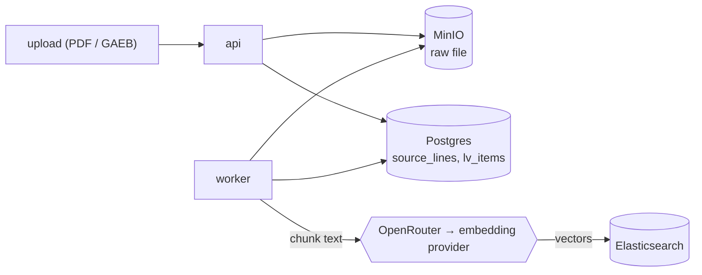
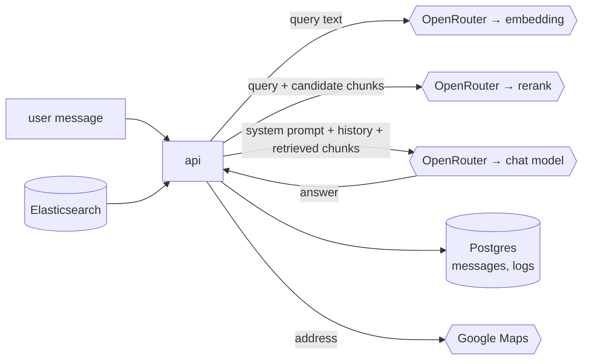
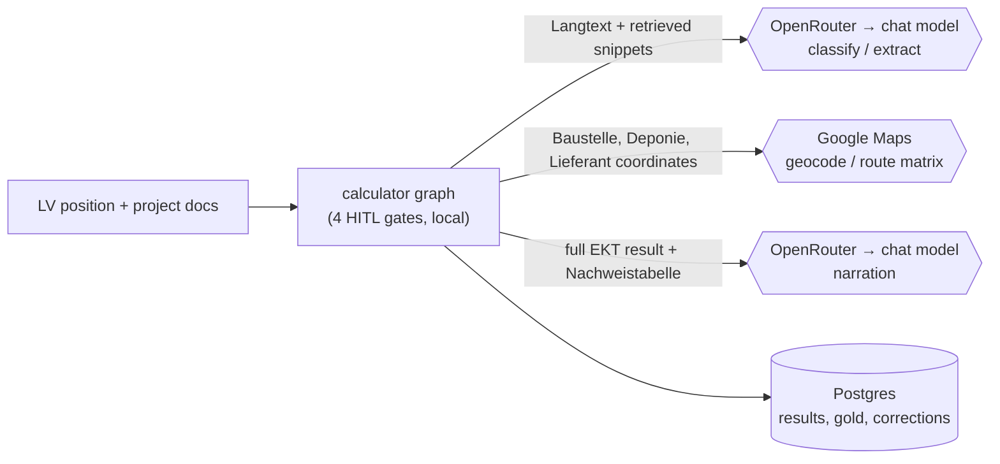

# Data Governance and Privacy

What data the system holds, where it lives, what leaves the deployment, and who can access it.
Written for the IT decision maker evaluating the system; readable without the architecture
documents. This document is deliberately complete about external data flows — including the
uncomfortable ones — because the people reading it will find them anyway. The purpose of this document
is to provide the reader with a clear risk assessment of the data privacy and AI ethics implications of this
specific project.

## What Data the System Holds

Ordered roughly by sensitivity, lowest first:

1. **Vergabeunterlagen** — the ingested tender documents (PDFs and GAEB files) and everything
   derived from them: extracted text lines, parsed LV positions, page thumbnails. In the normal
   case these are public procurement documents.
2. **Project context** — geocoded locations (Baustelle, Deponie) and site parameters. Individually
   harmless; collectively they say which tenders the firm is pursuing.
3. **Conversations** — chat and calculation transcripts, including the Kalkulator's questions,
   corrections, and judgments.
4. **The Katalog** — the firm's calculation reference data: machine hourly rates, productivity
   profiles, material prices, supplier price lists, costing formulas. Trade secrets.
5. **EKT results, gold data, and corrections** — per-position cost breakdowns with their full
   derivation trees. This is Urkalkulation-grade material: the kind of data that is submitted to
   an Auftraggeber only in a sealed envelope.
6. **Observability copies** — the prompt execution log and Phoenix traces store the full request
   and response of every LLM call, which means local copies of document excerpts, catalog rates,
   and cost breakdowns that were sent to models. The usage log stores tokens and cost only.

## Where Data Lives

Everything is self-hosted inside the deployment; no third-party service stores any of it:

- **Postgres** — the canonical store (documents' text, LV, conversations, Katalog, results, logs).
- **Elasticsearch** — the search indexes, including an **archive index** that retains superseded
  and deleted chunks (see Retention and Deletion).
- **MinIO** — original PDFs, thumbnails, rendered maps.
- **Phoenix** — LLM traces, on its own local volume. Treat it with database-grade confidentiality.

## Data Flow

Hexagons are external services — the only places data crosses the deployment boundary.

**Ingestion** — at ingestion time, the full text of every document leaves for embedding:

**Chat / retrieval** — queries, retrieved chunks, and history leave per turn:

**Calculation** — the LLM sites see position text and retrieved snippets; the final narration call
sees the complete result:

## What Leaves the System

The complete egress inventory. OpenRouter is the routing intermediary for the first three rows and
sees their full content; the downstream provider is whichever model is configured.

| Channel              | Content transmitted                                                                                                                                                                                                                                                                                                                              |
| -------------------- | ------------------------------------------------------------------------------------------------------------------------------------------------------------------------------------------------------------------------------------------------------------------------------------------------------------------------------------------------ |
| **Embedding calls**  | Raw chunk text of **every ingested document**, and every search query. The highest-volume channel: at ingestion, essentially the whole tender leaves the deployment.                                                                                                                                                                             |
| **Chat completions** | System prompts, chat history, LV text, and retrieved document chunks. Two flows carry more than document content: the **Katalog chat feeds catalog data — rates, prices, productivity profiles — into the model context on every turn**, and the **calculator's narration call receives the complete EKT result including the Nachweistabelle**. |
| **Rerank calls**     | The query plus the candidate chunk texts.                                                                                                                                                                                                                                                                                                        |
| **Google Maps**      | Addresses and coordinates of Baustelle, Deponie, and Lieferanten (geocoding, route matrices, map rendering). Metadata rather than content — but _which tender a firm is calculating_ is competitively revealing metadata. A documented egress with no replacement planned.                                                                       |
| **Dev tooling**      | The RAG ground-truth generator (`eval/generator/`) sends project document content to the Anthropic API. Development-time only; not part of the product runtime.                                                                                                                                                                                  |

Every model call is logged locally in full (request, response, tokens, cost, latency) — useful for
audit, and itself a sensitive store.

**Levers available today:** the model (and thereby the downstream provider) is chosen per call
site — every prompt version pins its model, and the calculator and Katalog chat have their own
model settings. OpenRouter's provider routing can exclude providers by data policy (training,
retention). What these levers cannot change today: _some_ external model sees the content of each
flow that uses it.

## Tenancy and Isolation

Single-tenant: one instance per contractor, no shared infrastructure between firms. Within an
instance, retrieval and chat are always project-scoped. There is no cross-project or cross-firm
data mixing by construction.

## Access Control

Stated plainly: **authentication is a development stub.** Every request — API and UI — acts as one
fixed administrator; there are no users, roles, or per-project permissions. The security boundary
of a deployment today is the network boundary around it. Real authentication (fastapi-users,
OAuth2/JWT, a separate already-provisioned auth database) is a planned enhancement; see
`APPLICATION_ARCHITECTURE.md`. Until it lands, an instance must be reachable only by people who
may see everything in it.

## Retention and Deletion

What deleting a project actually does:

- **Removed**: all project rows in Postgres via cascade (documents, extracted text, LV items,
  conversations and messages, context, eval runs and results, gold data, corrections); raw PDFs,
  thumbnails, and maps in MinIO; the project's chunks in the **live** search index.
- **Retained**: the project's chunks in the Elasticsearch **archive index** — deletion archives
  chunks (with a timestamp) rather than purging them, matching the re-ingestion flow; purging the
  archive is a manual operation today. Also retained: prompt execution log and usage rows (their
  project link is nulled so cost and audit history survive — and execution-log rows contain the
  full prompts, including document excerpts), and Phoenix traces. The Katalog is firm-level data
  and is untouched by project deletion by design.
- **Caveat**: the external cleanup (MinIO objects, index documents) is best-effort per document —
  the database delete is transactional, but a transient store failure can orphan blobs or chunks.

An operator with hard deletion requirements must currently combine project deletion with a manual
archive-index purge and execution-log/trace cleanup.

## Document Sensitivity

Vergabeunterlagen in the normal case are public documents: published tender packages with no
confidentiality restrictions. Ingesting and processing them through external models raises no
document-confidentiality issue. The exceptions are private tenders and projects of a classified or
sensitive nature (military or intelligence construction) — for these, see Suitability below.

## Trade-Secret Data and External Models

Full candor: with the default configuration, the firm's competitively sensitive data transits
OpenRouter to the configured frontier model in two flows — the Katalog chat (rates, prices,
productivity in the model context) and the calculator's narration (the complete per-position cost
breakdown). Document content additionally transits via embeddings, chat, and rerank, which in the
normal public-tender case is unproblematic.

The mitigation path is architectural, not aspirational: model selection is already per call site,
and the OpenRouter endpoint URLs are configuration. That makes a **split-model posture** — routing
the trade-secret-touching flows to a locally hosted or contractually trusted endpoint while
keeping frontier models for public document Q&A — a configuration exercise rather than a refactor.
The quality cost of any such switch is measurable in advance: run the evaluation suites against
the candidate model and compare baselines (`AI_EVALUATION.md`). Points of friction to plan for:
strict structured-output support varies across local serving stacks, and changing the embedding
model requires re-indexing the corpus (rebuildable by design).

## Suitability for Classified or Sensitive Projects

**The system is not currently suitable for classified or otherwise sensitive tender material. Do
not ingest it.** With the default configuration, document content reaches external model
providers, and site locations reach Google Maps — regardless of any provider's data policy, that
is an egress a classified project cannot accept.

Should a user need to bid on classified or sensitive projects, the solution would need to be
adapted to a **fully local, air-gapped deployment**: locally hosted models behind the existing
OpenAI-compatible transport seam (completion, embedding, and rerank), a re-embedded corpus,
self-hosted geocoding and routing in place of Google Maps, and an operating environment that meets
the formal handling requirements for classified material — which are organizational as much as
technical, and outside the scope of this software alone. The architecture keeps this adaptation
feasible (single transport seam, per-site model pinning, rebuildable indexes), but it is an
engineering undertaking, not a configuration toggle.

## AI Ethics Posture

The system is built to **augment the Kalkulator, not to replace them** — and in this domain that
is a legal fact, not a mission statement. In a German public tender the Urkalkulation is the
contractor's contractual representation of how its prices were formed: captured on the EFB-Preis
forms, submitted in a sealed envelope, and opened precisely when it matters most — Preisprüfung of
a suspiciously low bid, Nachtragskalkulation after scope changes, disputes over unit prices years
after award. The firm, and the Kalkulator who signs it off, must be able to stand behind every
number. That accountability cannot be delegated to a model, and the system is deliberately shaped
so that it never has to be:

- **The human decides, and the boundary is structural, not prompt-based.** The calculation agent
  stops at four gates for explicit decisions; low-confidence and high-stakes values are never
  auto-accepted. In the Katalog, the agent can only draft validated change bundles — activation is
  a human-only action, absent from its tool set entirely.
- **The LLM judges, deterministic code computes.** No number in an EKT result is produced by a
  language model: models propose classifications, matches, and values copied verbatim with an
  evidence quote, and a deterministic engine does all arithmetic. Every value the engine will
  consume is presented — with its source and confidence — at the variable review before the
  calculation runs.
- **Every value is auditable.** The Nachweistabelle records the source and evidence behind every
  value the calculation consumed, corrections are recorded with full provenance, and every LLM
  call is logged and traced. There is no unexplainable number.

**Residual risks, named.** Grounded, citation-backed retrieval reduces hallucination but does not
eliminate extraction or classification error, and the faithfulness of the final narration is a
known, currently ungraded evaluation gap (`AI_EVALUATION.md`). The most realistic failure mode is
not a model inventing a number — it is **automation bias**: a Kalkulator who, after enough good
runs, reviews pre-accepted values less carefully. The confidence surfacing and forced decisions at
the gates are designed against exactly this, and no design removes it entirely. The output is a
draft to be examined; the estimate remains human work product.

**Bias.** The system processes no data about persons or social groups; no demographic attribute
exists anywhere in the pipeline. The closest-looking input, the Lohnstufe, is a tariff wage class
attached to the classification of the work — what kind of labour an operation requires — not to
any individual: it prices the work, not the worker, and no person's pay is determined by this
system. The bias risks that do exist are statistical rather than social: the classifier can favour
common Bauverfahren over rare-but-correct ones, the Katalog-first reuse preference skews drafts
toward familiar recipes and suppliers, and retrieval quality varies with the quality of the source
documents. These skew estimates, not people — and they surface for correction at the gates and are
measured by the evaluation baselines rather than left to accumulate silently.
