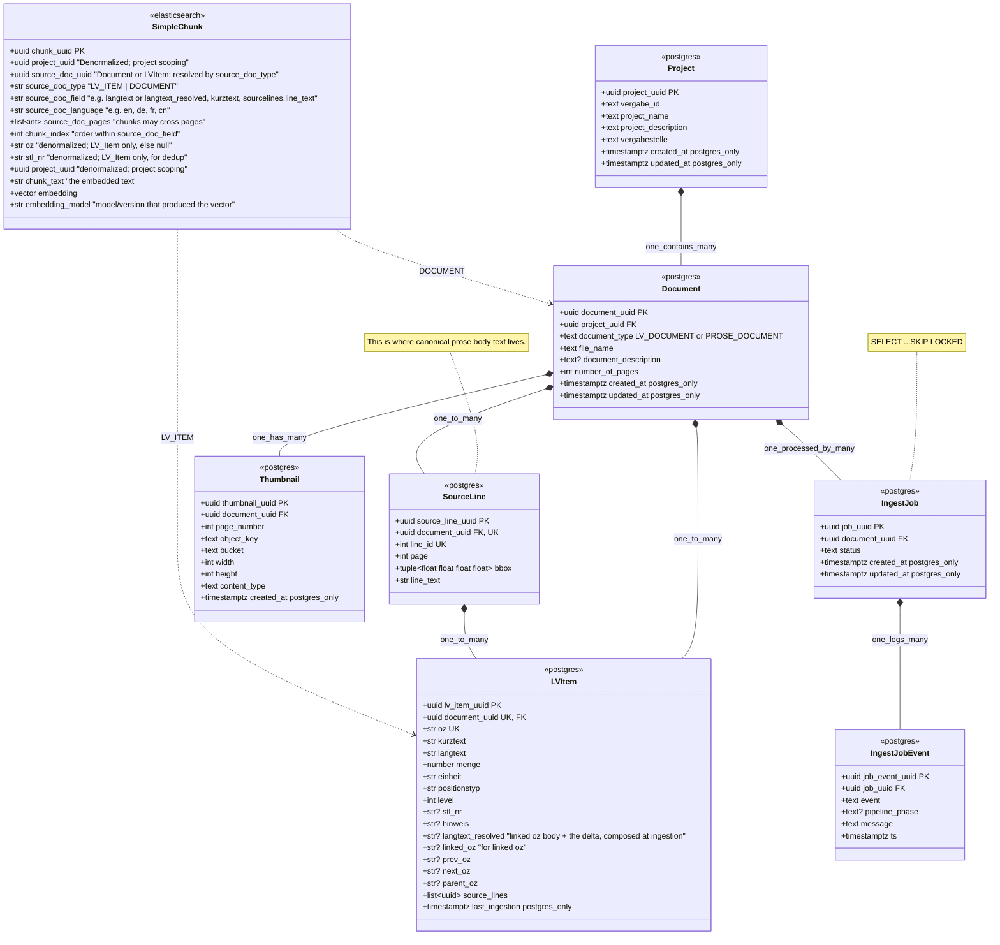

# Canonical Data Model

**This document is the single source of truth for entity names, fields, types, and cross-store
identity in Roadbuilders Assistant.** Where any other document disagrees with this one on a class name, a field name, a column
type, or a key, **this document wins.** The other docs keep their prose (the _why_ and the _how_);
this doc owns the _what is it called and what shape is it_.

# Naming & typing conventions

These rules are non-negotiable; they are how the ambiguity gets removed.

- **Postgres** — tables and columns are `snake_case`, plural table names (`projects`,
  `eval_items`). Surrogate primary keys are named `{singular_table}_uuid` (`project_uuid`,
  `eval_item_uuid`, `prompt_version_uuid`) — **not** `id`. Type is `UUID` with
  `server_default gen_random_uuid()`. Timestamps are `TIMESTAMPTZ`, `server_default now()`;
  mutable rows also carry `updated_at` with `onupdate now()`.
- **Pydantic domain models** — `PascalCase` class per aggregate, fields `snake_case` matching the
  column names exactly. Each aggregate has a `New{Entity}` create-model (no surrogate/timestamps)
  and an `{Entity}` read-model (all columns). `ConfigDict(extra="forbid")` everywhere.
- **API DTOs** — `PascalCase` with a `DTO` / `Create` / `Read` / `Update` suffix
  (`ProjectDTO`, `ProjectCreateDTO`, `PromptRead`). They are a **separate** type family from domain
  models and may expose a narrower field set.
- **TypeScript** — generated into `ui/src/types/generated.ts` from the DTOs; never hand-edited.
  Field names stay `snake_case` (they mirror the JSON wire shape).
- **Elasticsearch** — index and field names are `snake_case` (`roadbuilders_text`, `project_uuid`).
- **German domain terms are never translated.** `lv_item` not `bill_item`, `kurztext` not
  `short_text`, `vergabe_stelle` not `awarding_authority`, `menge`/`einheit`/`positionstyp` as-is.
  `GLOSSARY.md` is the source of truth for spelling.

# Data Model/Schema

- Every entity on this schema has at least a domain model (Pydantic, implementation agnostic)
- Every entity has an annotation about what implementations to make in addition to the domain model. It could be "postgres", "elasticsearch" or "postgres_elasticsearch".
- The annotation indicates where the implentations are targeted.
- If a field annotation has {implementation_targets}\_only, then that field goes only for the targeted implentations. otherwise, assume it goes on all defined implementations.

