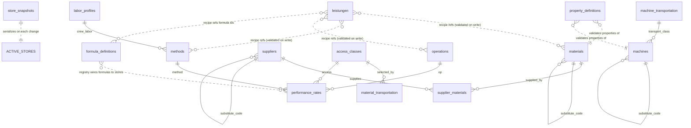

# Domain Store — Data-Driven Reference Stores for the EKT Calculator

## Context

The EKT calculator's deterministic value stores live today as hard-coded Python
dicts in `server/shared/services/calculator/stores.py` (material physics/prices,
BGL machine rates, mobilization, performance rates, crew norms, labor, trucks,
test norms, unit rates). The docstring already states the intent: *"In production
these are versioned database tables fed by Nachkalkulation, supplier quotes and
the BGL."*

This document specifies turning those dicts into a **real, UI-manageable data
store**. The design is driven by four hard requirements, which together rule out a
fixed typed-schema approach and point to a **data-driven, metadata-described**
model:

1. **No hard-coded vocabularies.** Adding, modifying, or *retiring* a machine
   class / material / method must be **data, not code or a redeploy**. A retired
   class (e.g. an emissions regulation forces a machine type out) must be able to
   designate a **substitute** that formulas and selectors follow transparently.
2. **Dynamic, queryable properties.** New material *categories* and *properties*
   will be added often, yet we must still answer SQL/UI questions like
   *"all materials with density > 2.1"*. The materials catalog spans aggregates,
   asphalt mixes, DSK, **emulsions**, milled arisings, and interlayers.
3. **Whole-store snapshot versioning.** *Any* data change snapshots the **entire**
   store and increments a global version number. Only the **active** store is ever
   queried; saved snapshots exist purely for **compliance / reference** and to
   record what a calculation run used.
4. **Formulas authorable as data.** New cost math should be addable without
   recoding/redeploying, via a small safe expression language (DSL) that coexists
   with the existing vetted Python formulas.

Domain refinements decided during design:

- `trucks` is renamed **`material_transportation`** (it is the delivery LKW,
  selected by site access).
- **`machine_transportation`** is promoted to a first-class catalog (todays
  `MOBILIZATION`): heavy/oversized haul (Schwertransport with permits) is a real,
  separately-priced resource shared across machines.
- **`suppliers`** (+ addresses) are added so material delivery distances can be
  derived; routing/selection/per-supplier pricing are explicitly deferred.
- **Leistungen fold into the store.** The registry recipes (`registry/*.yaml`)
  become a versioned `leistungen` entity — one JSONB `document` per work type,
  validated by the existing `Registry` model and seeded from today's YAML; the
  interpreter loads them from the DB. This collapses the two version axes (store
  snapshot + registry version) into one. **No publish gate yet** — this is a
  development prototype; the semantic dry-run / governance gate is deferred.

This explicitly **overrides** the repo convention "controlled value sets are
`StrEnum`; no magic strings" *for the store vocabularies* — those are an evolving
firm catalog, not a fixed code contract. Integrity is preserved by **FK to the
catalog table** instead of an enum CHECK. (System enums that are NOT domain data —
e.g. `CatalogStatus`, property `value_type` — stay `StrEnum`.)

---

## Architecture at a glance

Six pillars:

| # | Pillar | Mechanism |
|---|--------|-----------|
| 1 | Data-driven vocabularies | One **catalog table per kind**, keyed by stable `code`; FK-to-catalog replaces enum CHECK. |
| 2 | Substitution | `status` + `substitute_code` self-FK on every catalog; resolved in the accessor layer (chain + cycle guard). |
| 3 | Metadata-described properties | `property_definitions` registry + a validated `properties` JSONB bag per entry; queried via JSONB on the active store. |
| 4 | Whole-store snapshots | Live **active** tables (queried/edited) + append-only `store_snapshots` (one JSONB document per change) for compliance. |
| 5 | Relations | `performance_rates` and `supplier_materials` stay as FK relation tables (the catalog-entry shape does not fit a matrix / M:N). |
| 6 | Formula DSL | `formula_definitions` evaluated by a stdlib-`ast` whitelist evaluator, alongside `formulas.py`. |
| 7 | Leistungen as data | `registry/*.yaml` fold into a `leistungen` table (one JSONB `document` per work type, validated by `Registry`); the interpreter loads from the DB, one version axis with the rest of the store. |



---

## Entity inventory (old dict -> new table)

Every **catalog** table shares this baseline shape; kind-specific **FK columns**
are listed in the last column (FKs must be real columns; free scalars go in
`properties`):

`code, label, category, status, substitute_code, properties JSONB, created_at, updated_at`

| Table (active) | Replaces | Key `properties` (in JSONB) | Extra FK / structured columns |
|---|---|---|---|
| `materials` | `MATERIAL_PROPERTIES`, `MATERIAL_PRICES`, `INTERLAYER_PROPERTIES` | `price`, `price_unit`, `bulk_density_t_m3`, `loss{standard,elevated}`, `moisture_delta`, `kg_m2`, `emulsion_kg_m2`, `overlap_factor` | — |
| `machines` | `BGL_RATES` | `bgl_rate_eur_h` | `transport_class_code` -> `machine_transportation.code` |
| `machine_transportation` | `MOBILIZATION` | `eur_km`, `flat_eur`, `max_payload_t`, `max_height_m`, `permit_surcharge_eur` | — |
| `material_transportation` | `TRUCKS` | `payload_t`, `rate_eur_h` | `access_code` -> `access_classes.code` |
| `suppliers` | *new* | `contact`, `notes` | `street, house_no, postal_code, city, country, lat, lon` (structured) |
| `methods` | `CREW_NORMS` (keys) | `crew_size` | `labor_profile_code` -> `labor_profiles.code` |
| `labor_profiles` | `LABOR_PROFILES` | `mittellohn_eur_h` | — |
| `operations` | operation ids in `PERFORMANCE_RATES` | — | — |
| `access_classes` | `open`/`confined` | — | — |
| `test_norms` | `TEST_NORMS` | `area_per_test_m2`, `eur_per_test` | — |
| `unit_rates` | `UNIT_RATES` | `rate_eur_m2` | — |

**Relation tables** (FK to catalogs, no `properties` bag):

| Table | Replaces | Columns |
|---|---|---|
| `performance_rates` | `PERFORMANCE_RATES` | `operation_code`, `method_code`, `access_code` (FKs), `output_per_h`, `unit` |
| `supplier_materials` | *new* | `supplier_code`, `material_code` (FKs) — `price_eur_t` deferred |

**Document entity:** `leistungen` — the registry recipes folded in from
`registry/*.yaml` (one validated JSONB `document` per `work_type`).

**Infrastructure tables:** `property_definitions`, `formula_definitions`,
`store_snapshots`.

**Folded in / out of scope:** `crew_norm` -> `methods.properties.crew_size` +
`labor_profile_code`; interlayers/emulsions -> `materials` categories;
`FLEET_AVAILABILITY` stays **project-scoped** (not a reference store);
`CLIMATE_NORMALS` stays a stub.

### Glossary of the key entities

- **operation** — *what* work step is performed (`distribute`, `compact`, `pave`,
  `verlegen`, `verdichten`, `fräsen`, …).
- **method** — *how* an operation is carried out: the technique-and-equipment
  choice (Bauverfahren / Geräteeinsatz). E.g. `fertiger` (machine paving) vs
  `asphalt_handeinbau` (hand paving). It is the middle key of `performance_rates`
  and owns the crew composition (folded-in `CREW_NORMS`).
- **access_class** — the site condition that scales output: `open` / `confined`.
- **machine** — a BGL-rated piece of equipment; references a
  `machine_transportation` mode for getting it to site.
- **supplier** — a material source with an address; links to the materials it
  supplies via `supplier_materials`, enabling delivery-distance derivation.

---

## Schema (SQLAlchemy Core)

Tables follow the existing conventions in `server/shared/db/tables/` (shared
`metadata`, `UUID(as_uuid=True)` PK with `gen_random_uuid()`, `func.now()`
timestamps, `JSONB` from `sqlalchemy.dialects.postgresql`). New modules register
in `server/shared/db/tables/__init__.py`.

### System enums (these ARE fixed contracts -> stay StrEnum)

`server/shared/models/enums.py`:

```python
class CatalogStatus(StrEnum):
    ACTIVE = "active"
    RETIRED = "retired"

class PropertyValueType(StrEnum):
    NUMBER = "number"
    PERCENT = "percent"
    STRING = "string"
    NESTED = "nested"   # e.g. loss: {standard, elevated}
```

### Canonical catalog table (`machines`) — others share this shape

`server/shared/db/tables/machines.py`:

```python
from __future__ import annotations

from sqlalchemy import (
    CheckConstraint, Column, DateTime, ForeignKey, Table, Text,
    UniqueConstraint, func, text,
)
from sqlalchemy.dialects.postgresql import JSONB, UUID

from shared.db.metadata import metadata
from shared.models.enums import CatalogStatus

_STATUS_SQL = ", ".join(f"'{s.value}'" for s in CatalogStatus)

machines = Table(
    "machines",
    metadata,
    Column("machine_uuid", UUID(as_uuid=True), primary_key=True,
           server_default=text("gen_random_uuid()")),
    Column("code", Text, nullable=False),                 # stable key (registry/relations reference this)
    Column("label", Text, nullable=False),
    Column("category", Text, nullable=False),             # free data: earthwork|paving|compaction|milling...
    Column("status", Text, nullable=False, server_default=text(f"'{CatalogStatus.ACTIVE.value}'")),
    Column("substitute_code", Text, ForeignKey("machines.code"), nullable=True),  # self-ref on retire
    Column("transport_class_code", Text, ForeignKey("machine_transportation.code"), nullable=True),
    Column("properties", JSONB, nullable=False, server_default=text("'{}'::jsonb")),
    Column("created_at", DateTime(timezone=True), nullable=False, server_default=func.now()),
    Column("updated_at", DateTime(timezone=True), nullable=False,
           server_default=func.now(), onupdate=func.now()),
    UniqueConstraint("code", name="uq_machines_code"),    # required for the self/extern FKs to code
    CheckConstraint(f"status IN ({_STATUS_SQL})", name="status_valid"),
)
```

`materials`, `material_transportation`, `methods`, `labor_profiles`,
`operations`, `access_classes`, `test_norms`, `unit_rates`,
`machine_transportation` are the **same shape** minus/plus the kind-specific FK
columns from the inventory table.

### Suppliers (catalog shape + structured, geo-ready address)

`server/shared/db/tables/suppliers.py`:

```python
suppliers = Table(
    "suppliers",
    metadata,
    Column("supplier_uuid", UUID(as_uuid=True), primary_key=True,
           server_default=text("gen_random_uuid()")),
    Column("code", Text, nullable=False),
    Column("label", Text, nullable=False),                 # firm name
    Column("category", Text, nullable=False),              # steinbruch|mischwerk|recycling|emulsionswerk
    Column("status", Text, nullable=False, server_default=text("'active'")),
    Column("substitute_code", Text, ForeignKey("suppliers.code"), nullable=True),
    # Address as real columns -> the mapping feature queries/routes on these.
    Column("street", Text, nullable=True),
    Column("house_no", Text, nullable=True),
    Column("postal_code", Text, nullable=True),
    Column("city", Text, nullable=True),
    Column("country", Text, nullable=False, server_default=text("'DE'")),
    Column("lat", Float, nullable=True),                    # geocoded; filled by mapping feature
    Column("lon", Float, nullable=True),
    Column("properties", JSONB, nullable=False, server_default=text("'{}'::jsonb")),
    Column("created_at", DateTime(timezone=True), nullable=False, server_default=func.now()),
    Column("updated_at", DateTime(timezone=True), nullable=False,
           server_default=func.now(), onupdate=func.now()),
    UniqueConstraint("code", name="uq_suppliers_code"),
)
```

### Relation tables

```python
# server/shared/db/tables/performance_rates.py
performance_rates = Table(
    "performance_rates", metadata,
    Column("performance_rate_uuid", UUID(as_uuid=True), primary_key=True,
           server_default=text("gen_random_uuid()")),
    Column("operation_code", Text, ForeignKey("operations.code"), nullable=False),
    Column("method_code", Text, ForeignKey("methods.code"), nullable=False),
    Column("access_code", Text, ForeignKey("access_classes.code"), nullable=False),
    Column("output_per_h", Numeric(12, 4), nullable=False),
    Column("unit", Text, nullable=False),                  # m3/h | m2/h | m/h
    Column("created_at", DateTime(timezone=True), nullable=False, server_default=func.now()),
    Column("updated_at", DateTime(timezone=True), nullable=False,
           server_default=func.now(), onupdate=func.now()),
    UniqueConstraint("operation_code", "method_code", "access_code"),
)

# server/shared/db/tables/supplier_materials.py
supplier_materials = Table(
    "supplier_materials", metadata,
    Column("supplier_material_uuid", UUID(as_uuid=True), primary_key=True,
           server_default=text("gen_random_uuid()")),
    Column("supplier_code", Text, ForeignKey("suppliers.code"), nullable=False),
    Column("material_code", Text, ForeignKey("materials.code"), nullable=False),
    # price_eur_t deferred (per-supplier quotes) -> add when supplier pricing lands.
    Column("created_at", DateTime(timezone=True), nullable=False, server_default=func.now()),
    UniqueConstraint("supplier_code", "material_code"),
)
```

### Property definition registry

```python
# server/shared/db/tables/property_definitions.py
property_definitions = Table(
    "property_definitions", metadata,
    Column("property_definition_uuid", UUID(as_uuid=True), primary_key=True,
           server_default=text("gen_random_uuid()")),
    Column("kind", Text, nullable=False),        # material | machine | machine_transportation | ...
    Column("category", Text, nullable=True),     # NULL = applies to all categories of the kind
    Column("code", Text, nullable=False),        # property key inside the JSONB bag (e.g. bulk_density_t_m3)
    Column("label", Text, nullable=False),
    Column("value_type", Text, nullable=False),  # PropertyValueType
    Column("unit", Text, nullable=True),         # t/m3, %, EUR/t, kg/m2...
    Column("required", Boolean, nullable=False, server_default=text("false")),
    Column("created_at", DateTime(timezone=True), nullable=False, server_default=func.now()),
    Column("updated_at", DateTime(timezone=True), nullable=False,
           server_default=func.now(), onupdate=func.now()),
    UniqueConstraint("kind", "category", "code"),
)
```

### Formula definitions (DSL)

```python
# server/shared/db/tables/formula_definitions.py
formula_definitions = Table(
    "formula_definitions", metadata,
    Column("formula_uuid", UUID(as_uuid=True), primary_key=True,
           server_default=text("gen_random_uuid()")),
    Column("code", Text, nullable=False),        # registry rows reference this as `formula_def:`
    Column("expression", Text, nullable=False),  # DSL text, e.g. "tonnage_t * price_eur_t"
    Column("inputs", JSONB, nullable=False),     # [{name, type, unit}] declared input contract
    Column("output_unit", Text, nullable=True),
    Column("kostenart", Text, nullable=True),    # VHB 223 mapping (mirrors FORMULA_KOSTENART)
    Column("created_at", DateTime(timezone=True), nullable=False, server_default=func.now()),
    Column("updated_at", DateTime(timezone=True), nullable=False,
           server_default=func.now(), onupdate=func.now()),
    UniqueConstraint("code"),
)
```

### Snapshot archive (compliance / reference only)

```python
# server/shared/db/tables/store_snapshots.py
store_snapshots = Table(
    "store_snapshots", metadata,
    Column("version_no", Integer, primary_key=True),       # global, monotonic (max+1, like prompt_versions)
    Column("created_at", DateTime(timezone=True), nullable=False, server_default=func.now()),
    Column("label", Text, nullable=True),
    Column("change_summary", Text, nullable=True),
    Column("data", JSONB, nullable=False),                 # full serialization of EVERY active store
)
```

---

## Pillar detail + code samples

### 2. Substitution (resolved in the accessor, transparent to formulas/LLM)

Retiring a catalog entry sets `status='retired'` and `substitute_code` to an
active peer. Lookups resolve the chain to the first active entry; a cycle is a
hard error (crash, not silent).

```python
# server/shared/services/calculator/store_set.py  (excerpt)
def _resolve(entries: dict[str, CatalogEntry], code: str) -> CatalogEntry:
    seen: set[str] = set()
    while True:
        if code in seen:
            raise StoreResolutionError(f"substitute cycle through {code!r}")
        entry = entries.get(code)
        if entry is None:
            raise StoreResolutionError(f"unknown code {code!r}")
        if entry.status == CatalogStatus.ACTIVE:
            return entry
        if entry.substitute_code is None:
            raise StoreResolutionError(f"{code!r} retired with no substitute")
        seen.add(code)
        code = entry.substitute_code
```

Substitution runs on **every key**, including the FK keys of relation lookups
(`performance_rate(op, method, access)` resolves `method` -> substitute before
the matrix lookup).

**LLM consequence:** the allowed option sets the EKT graph offers (classify /
select-method, in `llm_calls.py`) are currently implicit in the store keys. Once
the vocab is data, the **active** catalog must be injected into those
structured-output schemas at runtime; retired entries are hidden from selection
but still resolvable when replaying an old run.

### 3. Metadata-described properties (validated on write, queried on read)

The `properties` JSONB bag stores exactly the dict shape the formulas already
consume, so the accessor contract is unchanged (the formulas in `formulas.py`
read `material["loss"]["standard"]`, `material["kg_m2"]`, `truck["payload_t"]`,
`machine["eur_km"]`, etc.). On write, the service validates the bag against
`property_definitions` for the entry's `(kind, category)`. For materials, a
Pydantic discriminated union is the validator (mirrors `IngestEvent` in
`ingest_schema.py`):

```python
# server/shared/models/store_properties.py (excerpt)
class Loss(BaseModel):
    model_config = ConfigDict(extra="forbid")
    standard: float
    elevated: float

class AggregateProps(BaseModel):
    model_config = ConfigDict(extra="forbid")
    category: Literal["aggregate"]
    price: Decimal
    price_unit: str = "EUR/t"
    bulk_density_t_m3: float
    loss: Loss
    moisture_delta: float | None = None

class DskProps(BaseModel):
    category: Literal["dsk"]
    price: Decimal
    price_unit: str = "EUR/t"
    kg_m2: float

class EmulsionProps(BaseModel):
    category: Literal["emulsion"]
    price: Decimal
    price_unit: str = "EUR/kg"
    emulsion_kg_m2: float

MaterialProperties = Annotated[
    AggregateProps | DskProps | EmulsionProps,  # + asphalt | milling | interlayer
    Field(discriminator="category"),
]
```

**Query** ("density > 2.1") runs against the **active** table via JSONB, with an
expression index on hot paths:

```sql
SELECT code, label FROM materials
WHERE status = 'active'
  AND (properties->>'bulk_density_t_m3')::numeric > 2.1;
-- CREATE INDEX ix_materials_density ON materials (((properties->>'bulk_density_t_m3')::numeric));
```

### 4. Whole-store snapshot versioning

Active tables are plain CRUD (the only thing queried/edited). Every change writes
**one immutable snapshot document** of the whole store, in the same transaction:

```python
# server/shared/services/calculator/store_versioning.py (excerpt)
async def apply_and_snapshot(conn: AsyncConnection, mutate, *, label: str | None = None) -> int:
    """Apply edits to the active tables, then archive the full store as the next version."""
    await mutate(conn)                                  # repository writes against active tables
    data = await serialize_active_stores(conn)         # read every active table -> JSON-able dict
    next_no = (await conn.execute(
        select(func.coalesce(func.max(store_snapshots.c.version_no), 0) + 1)
    )).scalar_one()
    await conn.execute(insert(store_snapshots).values(version_no=next_no, data=data, label=label))
    return next_no
```

A calculation run records the `version_no` current at load time (alongside the
existing per-param provenance), so compliance can fetch the exact snapshot the
number was produced from. The calculator reads the **active** store once up front
(same pattern as `load_calculator_prompts` in `calculator/prompts.py`).

### 6. Formula DSL (safe `ast` evaluator, no new dependency)

Stored formulas are short expressions evaluated by a **whitelist** AST walker —
safe by construction (only the allowed node types/functions can run; no `eval`,
no attribute access, no imports). Nearly every current formula is already a
one-liner; `ceil`/`round`/`min`/`max` + an if-expression cover the rest.

```python
# server/shared/services/calculator/formula_dsl.py (excerpt)
import ast, math, operator as op

_BIN = {ast.Add: op.add, ast.Sub: op.sub, ast.Mult: op.mul,
        ast.Div: op.truediv, ast.Pow: op.pow, ast.Mod: op.mod}
_CMP = {ast.Gt: op.gt, ast.GtE: op.ge, ast.Lt: op.lt, ast.LtE: op.le,
        ast.Eq: op.eq, ast.NotEq: op.ne}
_FUNCS = {"ceil": math.ceil, "floor": math.floor, "round": round, "min": min, "max": max}

class FormulaError(Exception): ...

def evaluate(expression: str, variables: dict[str, float]) -> float:
    return _eval(ast.parse(expression, mode="eval").body, variables)

def _eval(node, v):
    if isinstance(node, ast.Constant) and isinstance(node.value, (int, float)):
        return node.value
    if isinstance(node, ast.Name):
        if node.id in v: return v[node.id]
        raise FormulaError(f"unknown variable {node.id!r}")
    if isinstance(node, ast.BinOp) and type(node.op) in _BIN:
        return _BIN[type(node.op)](_eval(node.left, v), _eval(node.right, v))
    if isinstance(node, ast.UnaryOp) and isinstance(node.op, (ast.UAdd, ast.USub)):
        x = _eval(node.operand, v); return x if isinstance(node.op, ast.UAdd) else -x
    if isinstance(node, ast.Compare) and len(node.ops) == 1 and type(node.ops[0]) in _CMP:
        return _CMP[type(node.ops[0])](_eval(node.left, v), _eval(node.comparators[0], v))
    if isinstance(node, ast.IfExp):
        return _eval(node.body, v) if _eval(node.test, v) else _eval(node.orelse, v)
    if isinstance(node, ast.Call) and isinstance(node.func, ast.Name) \
            and node.func.id in _FUNCS and not node.keywords:
        return _FUNCS[node.func.id](*[_eval(a, v) for a in node.args])
    raise FormulaError(f"disallowed expression: {ast.dump(node)}")
```

Coexistence: a registry row references either `formula:` (existing Python in
`formulas.py`, kept for genuinely imperative math) or `formula_def:` (a DSL row).
`inputs` reuses the existing `ParamSpec` resolution + Pydantic completeness gate
(`graph.py: resolve_params`). **Risk is designed-for, not fully enforced now**
(prototype): whitelist evaluation is in from day one; declared `unit`s are stored
as metadata and checked later; expressions are pure (no I/O, no loops). A richer
grammar later (`simpleeval`/`lark`) would be a dependency decision.

### 7. Leistungen as a versioned store entity

The registry recipes fold into the store as a `leistungen` table holding one
**validated JSONB document** per work type — not shredded into relational rows.
The existing `Registry` Pydantic model (`models.py`, which already validates the
YAML at load time) is the write-time validator; today's `registry/*.yaml` files
become the **seed**, and the interpreter loads active rows from the DB instead of
globbing files.

```python
# server/shared/db/tables/leistungen.py
leistungen = Table(
    "leistungen", metadata,
    Column("leistung_uuid", UUID(as_uuid=True), primary_key=True,
           server_default=text("gen_random_uuid()")),
    Column("work_type", Text, nullable=False),    # stable code; classify maps an LV position to it
    Column("label", Text, nullable=False),
    Column("status", Text, nullable=False, server_default=text("'active'")),
    Column("document", JSONB, nullable=False),     # full recipe, validated by models.Registry
    Column("created_at", DateTime(timezone=True), nullable=False, server_default=func.now()),
    Column("updated_at", DateTime(timezone=True), nullable=False,
           server_default=func.now(), onupdate=func.now()),
    UniqueConstraint("work_type", name="uq_leistungen_work_type"),
)
```

Two **write-time validations** (data-correctness, NOT the deferred governance
gate):

1. **Shape** — `Registry.model_validate(document)` (reuses the load-time validator).
2. **Reference integrity** — every code the recipe names (`material_spec`
   options, `machine_class`, `operation`/`method` ids, `formula`/`formula_def`)
   must exist in the active catalogs / `formula_definitions`; dangling references
   are rejected. This is the integrity the file-based registry never had.

**Versioning:** a Leistung edit bumps the same global `store_snapshots.version_no`
as any other store change (the per-YAML `version:` field collapses into it), so a
run pins ONE number to reproduce data + recipes together.

**No publish gate (prototype).** Edits go live immediately; the
reference-position dry-run / EKT-delta governance is **deferred** until the
concept is proven. The method -> `machine_class` binding stays inside the recipe
`document` for now (normalizing it onto the `methods` catalog is a later
refinement).

Loader change: where `graph.py` currently reads the registry from
`registry/*.yaml`, it instead loads active rows via a `LeistungRepository`,
parsing each `document` with `Registry`; the classify step offers the active
`work_type`s.

### Accessor integration (`STORES` -> `StoreSet`)

`graph.py` currently calls module-level `STORES[spec.call](*args)`. It will
instead receive a `StoreSet` loaded once per run from the active DB store, whose
methods return the **same shapes** the formulas expect and apply substitution:

```python
class StoreSet:
    def material_property(self, spec: str) -> dict:
        return _resolve(self._materials, spec).properties
    def material_price(self, spec: str) -> float:
        return float(_resolve(self._materials, spec).properties["price"])
    def bgl_rate(self, code: str) -> float:
        return float(_resolve(self._machines, code).properties["bgl_rate_eur_h"])
    def mobilization_rate(self, code: str) -> dict:
        machine = _resolve(self._machines, code)
        return _resolve(self._machine_transport, machine.transport_class_code).properties
    def performance_rate(self, op_: str, method: str, access: str) -> float:
        m = _resolve(self._methods, method).code      # substitution before matrix lookup
        return float(self._perf[(op_, m, access)])
    # crew_norm, labor_profile, truck_for_access, test_norm, unit_rate, interlayer_property ...
```

---

## Models, repositories, API, UI

- **Pydantic** (`server/shared/models/`): one read model + `New*` create model per
  table, `ConfigDict(from_attributes=True, extra="forbid")` (mirrors
  `prompt_version.py`). Catalog read models carry `properties: dict[str, Any]`;
  validation against `property_definitions` / the discriminated union happens in
  the service on write.
- **Repositories** (`server/shared/repositories/`): one per table, constructed
  with `AsyncConnection`, Core CRUD returning Pydantic via `model_validate(dict(row))`
  (mirrors `projects.py`). Writes go through the versioning service so each save
  snapshots.
- **Services** (`server/shared/services/calculator/`): `store_set.py` (load +
  resolve), `store_versioning.py` (apply + snapshot + serialize), property
  validation. All business logic here; routes stay thin.
- **API** (`server/api/routes/`): one resource file per store kind (CRUD) +
  `store_snapshots` (read/list) + `property_definitions`. Thin wrappers only.
- **UI** (`ui/src/`): one React Query resource file per store in `ui/src/api/`
  (e.g. `materials.ts`, `machines.ts`, `suppliers.ts`) with a typed key factory;
  a `views/stores/` area for the management grids/forms (forms rendered from
  `property_definitions`). Run `npm run gen:types` after the schema lands.

---

## Seeding & migration

- Schema: idempotent `metadata.create_all` via the existing
  `server/scripts/bootstrap_tables.py` after registering the new table modules in
  `tables/__init__.py`.
- Seed: `server/scripts/seed/stores/` (mirrors `scripts/seed/prompts/`) lifts the
  current dicts straight from `stores.py` into the active tables + seeds
  `property_definitions` + `formula_definitions`, then writes the first
  `store_snapshots` row (version 1). `from shared.services.calculator.stores import ...`
  keeps a single source for the seed values.
- Leistungen seed: load every `registry/*.yaml`, validate each with `Registry`,
  and insert one `leistungen` row per `work_type` (the YAML becomes seed data,
  exactly as `stores.py` does for the catalogs).

---

## Naming contract (single source of truth)

- Table names are owned by their `Table(...)` object; the `code`/`category`
  vocabularies are **data** (rows), not code constants.
- The **property keys** the accessors read (`bgl_rate_eur_h`, `bulk_density_t_m3`,
  `eur_km`, `payload_t`, `price`, ...) are the contract between `StoreSet` and the
  seeded `property_definitions`. Promote each to a `SCREAMING_SNAKE` module
  constant next to the accessor that reads it, referenced on both the seed side
  and the read side.

---

## Staged rollout

1. **Scaffolding** — `CatalogStatus`/`PropertyValueType` enums,
   `property_definitions`, `store_snapshots`, versioning service + serializer.
2. **Machine slice (vertical, validated end-to-end)** — `machines` +
   `machine_transportation` + property defs + repos + models + seed + `StoreSet`
   accessors for `bgl_rate`/`mobilization_rate` + snapshot-on-write. Proves
   catalog + FK + substitution + JSONB + snapshot together.
3. **Materials** — catalog + discriminated-union validation; fold in interlayers,
   emulsions, milled arisings, water; accessors.
4. **Remaining catalogs + relations** — `material_transportation`,
   `labor_profiles`, `methods`, `operations`, `access_classes`, `test_norms`,
   `unit_rates`, `performance_rates`, `suppliers`, `supplier_materials`.
5. **Swap calculator to DB** — `graph.py` consumes `StoreSet` (substitution +
   snapshot read) instead of module `STORES`; inject active vocab into the EKT
   LLM schemas. `stores.py` becomes the seed source only.
6. **Leistungen to DB** — `leistungen` table + `LeistungRepository` + write-time
   shape/reference validation; seed from `registry/*.yaml`; the interpreter loads
   recipes from the DB and classify offers active `work_type`s. `registry/*.yaml`
   becomes the seed source only.
7. **Formula DSL** — `formula_definitions` + `formula_dsl.py` + registry
   `formula_def:` support; migrate the one-line formulas, keep imperative ones.
8. **API + UI** — CRUD routes + React store-management views (incl. a Leistung
   document editor).

**Out of scope (flagged, easy extensions):** supplier route/distance computation
& supplier selection (ties into the existing project-chat mapping feature),
per-supplier pricing (`supplier_materials.price_eur_t`), multi-plant suppliers,
`FLEET_AVAILABILITY` (project-scoped), `CLIMATE_NORMALS`, DSL unit enforcement,
**Leistung publish gate / reference-position dry-run (governance) — deferred
until the concept is proven**, normalizing method->`machine_class` onto the
`methods` catalog, PostGIS.

---

## Verification

- **Golden equivalence test (critical):** run the EKT calculator for a set of LV
  positions against the seeded DB-backed `StoreSet` and assert the produced
  numbers are **identical** to the current in-memory `stores.py`. This proves the
  migration is behavior-preserving.
- **Unit:** `formula_dsl.evaluate` (whitelist accepts the real formulas, rejects
  `__import__`/attribute access/unknown names); substitution resolver (chain
  resolves, cycle raises, retired-without-substitute raises); property validation
  (discriminated union rejects wrong/missing keys per category);
  `apply_and_snapshot` (version increments, `data` captures every active table).
- **Integration:** repository CRUD per table; `store_versioning` end-to-end (edit
  -> new snapshot -> active query reflects edit, snapshot frozen).
- **Leistungen:** every seeded `registry/*.yaml` round-trips through `Registry`
  validation into a `leistungen` row; reference-integrity rejects a recipe naming
  a code absent from the active catalog; the calculator loading recipes from the
  DB produces the same EKT as loading them from the YAML files (extends the golden
  test).
- **Manual:** `python -m scripts.seed.stores` then `scripts/run_calculator.py`;
  in the UI, edit a machine rate -> confirm a new `version_no` and the calc picks
  up the new active value.
