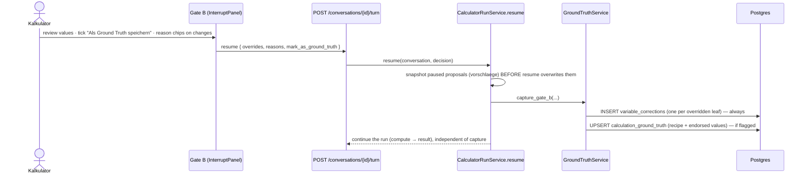
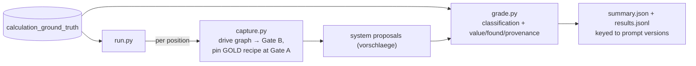
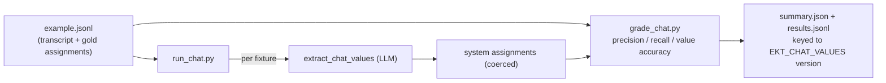
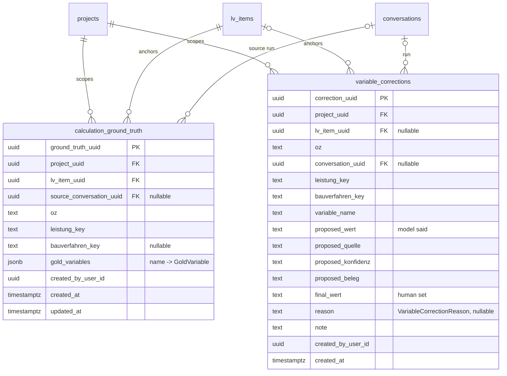
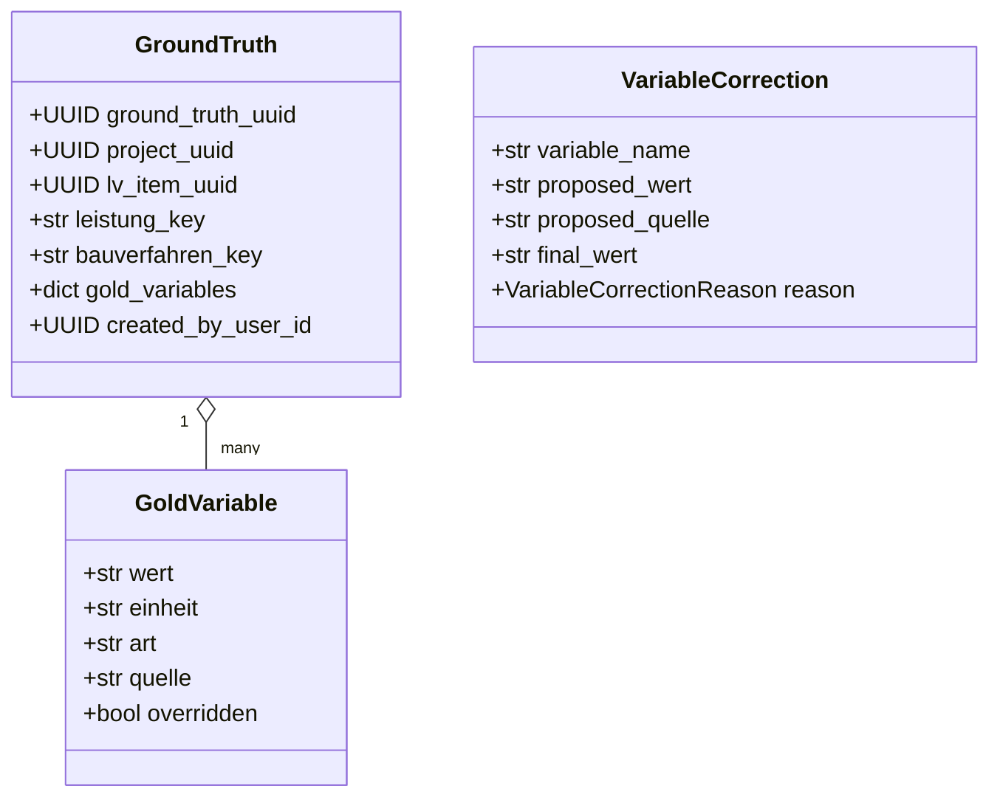

# EVAL_STATUS.md

Status of LLM evaluation for the EKT calculator. Scope so far: the calculator's **structured
extraction** LLM calls — the parts whose correctness is deterministically gradeable. The deterministic
calc engine is trusted, so grading the LLM-extracted *inputs* covers the model's error surface without
needing reference prices.

Branch: `worktree-eval-ground-truth-capture` (3 commits: `1d126ce`, `eb82ddd`, `2b3f911`).

## 1. At a glance

| Calculator LLM call | Prompt type | What it does | Eval | Status |
|---|---|---|---|---|
| Classify Leistung | `EKT_LEISTUNG_CLASSIFY` | position → Leistung | `run.py` (`classification_accuracy`) | ✅ built |
| Extract variable | `EKT_LANGTEXT_EXTRACT` | one var from Langtext/RAG | `run.py` (value/found/provenance) | ✅ built |
| Extract chat values | `EKT_CHAT_VALUES` | harvest values stated in chat | `run_chat.py` (precision/recall) | ✅ built |
| Narrate output | `EKT_OUTPUT_NARRATE` | free-text result prose | faithfulness judge | ❌ not built |

"Built" = code + pure-logic unit tests landed and green; the live runners are import-checked but have
**not** been executed end-to-end against a live stack yet (needs DB + Elasticsearch + OpenRouter, plus
captured gold / authored fixtures).

## 2. The two halves

Evaluation is split into **in-product capture** (build the gold set as a byproduct of real review
work) and **offline grading** (re-run extraction and score it against the gold).

### 2a. Capture (in-product, at Gate B)

The HITL gates already produce expert-corrected decisions: by Gate B the `leistung_key` /
`bauverfahren_key` are whatever the Kalkulator confirmed at Gate A, and the variable values are the
reviewed proposals. "Save as ground truth" just persists that state. Corrections are logged on *every*
override regardless, as error-analysis telemetry.



Capture happens **before** the resume runs compute, so it is independent of whether the price
calculation later succeeds.

### 2b. Grade (offline)



Pinning the gold recipe at Gate A decouples extraction quality from classification (which is scored
separately, from the system's own Gate A choice). Chat-value extraction is graded on its own, from
authored fixtures:



## 3. Data model

Two new tables on the **domain** MetaData. `created_by_user_id` is a plain UUID (the domain DB never
joins to auth). Gold upserts latest per `(project, position)`; corrections are append-only.



`gold_variables` is `name → GoldVariable`:



`GoldVariable.art` is `eingabe | satz | stammdaten`; `quelle` is `langtext | rag | konstante |
stammdaten | hitl` (`hitl` when the value was overridden).

### Correction reason taxonomy (drives metric validity)

`VariableCorrectionReason` separates model errors from expert/data reasons. Only model-error
corrections count against extraction accuracy; the rest are tracked separately.

| Reason | Meaning | Counts as model error? |
|---|---|---|
| `falscher_wert` | model misread the value | ✅ yes |
| `falsche_quelle` | value was findable but missed / wrong provenance | ✅ yes |
| `einheit` | unit / conversion mistake | ✅ yes |
| `kontext_fehlt` | value not in the documents | ⚠️ no (data gap) |
| `kalkulator_ermessen` | expert judgement / risk buffer | ❌ no (preference) |
| `sonstiges` | other (+ note) | ⚠️ unclassified |

## 4. Component map

| Layer | Path |
|---|---|
| DDL | `sql/09_ground_truth_capture.sql` |
| Tables | `server/shared/db/tables/{calculation_ground_truth,variable_corrections}.py` |
| Enum | `server/shared/models/enums.py` → `VariableCorrectionReason` |
| Models | `server/shared/models/ground_truth.py` |
| Repositories | `server/shared/repositories/{ground_truth,variable_corrections}.py` |
| Capture service | `server/shared/services/ground_truth.py` |
| Capture wiring | `server/shared/services/calculator/run_service.py` → `_capture_gate_b` |
| API | `server/api/routes/conversations.py` → `CalculationResume` (`reasons`, `mark_as_ground_truth`) |
| UI | `ui/src/views/workspace/InterruptPanel.tsx`, `ui/src/api/calculations.ts` |
| Grader (variables) | `server/scripts/eval_calculator/{grade,capture,run}.py` |
| Grader (chat) | `server/scripts/eval_calculator/{grade_chat,run_chat}.py` |
| Fixtures | `eval/calculator/chat_values/example.jsonl` |
| Results (git-ignored) | `eval/calculator/results/` |
| Tests | `tests/unit/services/test_ground_truth.py`, `tests/unit/eval/test_grade.py`, `tests/unit/eval/test_grade_chat.py` |

## 5. Metrics

All grading is deterministic (Decimal comparison with `--abs-tol`); no LLM judge. EINGABE leaves are
the model-extracted ones; SATZ/STAMMDATEN are catalog lookups, excluded from the headline.

**Variable extraction (`run.py` → `grade.py`)**

| Metric | Definition |
|---|---|
| `classification_accuracy` | re-run's `leistung_key` == gold (system's own Gate A choice) |
| `value_accuracy` | of EINGABE values that should be found, fraction matching gold within tolerance |
| `found_recall` | of EINGABE values that should be found, fraction the re-run produced at all |
| `provenance_accuracy` | fraction with the right source, over **assessable** leaves (overridden gold is excluded — its `quelle` is `hitl`) |

**Chat-value extraction (`run_chat.py` → `grade_chat.py`)** — set-shaped over `(name, value)`:

| Metric | Definition |
|---|---|
| `precision` / `recall` / `f1` | a true positive needs the right name **and** value |
| `name_recall` | gold names emitted at all (regardless of value) / gold |
| `value_accuracy` | of emitted gold names, fraction with the right value |
| `spurious` | names emitted that aren't in gold (hallucinated / off-catalog) |
| `exact_fixtures` | fixtures with every gold assignment correct and nothing spurious |

## 6. Verification

- **321 unit tests pass**, 9 skipped (`uv run pytest tests/unit`). New: `test_ground_truth` (4),
  `test_grade` (5), `test_grade_chat` (4).
- UI `tsc --noEmit` clean.
- All eval modules import; `example.jsonl` parses; fixture names match `CHAT_KATALOG`.
- **Not yet run live.** The two runners need DB + Elasticsearch + OpenRouter, plus captured gold /
  fixtures, to produce real numbers.

## 7. How to run

See [§8](#8-running-the-chat-value-eval) for the chat-value eval specifically.

### Prerequisites (once)

1. Apply the DDL to the database:
   ```bash
   psql -d roadbuilders -f sql/09_ground_truth_capture.sql
   ```
2. Make sure the project is ingested (the variable grader's RAG step needs it in Elasticsearch).
3. The scripts are a deps-only project (`package = false`), so `server/` must be on the path. From the
   repo root, prefix with `PYTHONPATH=server`.

### Capture gold (variable extraction)

In the UI, calculate a few positions; at Gate B tick **"Als Ground Truth speichern"** and pick a reason
chip on any value you change. Each save upserts `calculation_ground_truth`; each override logs a
`variable_corrections` row.

### Grade variable extraction

```bash
PYTHONPATH=server uv run python -m scripts.eval_calculator.run \
  --project <project_uuid> [--abs-tol 0] [--limit N]
```

Writes `eval/calculator/results/<project>-<timestamp>.{jsonl,summary.json}` and prints the summary +
the prompt versions used (the regression key).

## 8. Running the chat-value eval

The chat-value eval scores `EKT_CHAT_VALUES` against authored fixtures — no DB gold, no retrieval,
no graph. It needs only Postgres (to load the prompt) and OpenRouter.

### `run_chat.py` (the CLI)

```bash
# from the repo root:
PYTHONPATH=server uv run python -m scripts.eval_calculator.run_chat \
  --dataset eval/calculator/chat_values/example.jsonl
```

Options: `--abs-tol <n>` (absolute numeric tolerance, default exact) · `--out <dir>` (results dir,
default `eval/calculator/results/`).

It replays `extract_chat_values` over each transcript with the current prompt, coerces each verbatim
read the way the graph node does, grades, and writes
`eval/calculator/results/chat-<dataset>-<timestamp>.{jsonl,summary.json}` plus a printed summary keyed
to the `EKT_CHAT_VALUES` version.

**Authoring fixtures** — one JSON object per line (`//` comment lines ignored). Names are
`KONTEXT_VARIABLEN` keys; values are verbatim in the variable's own unit (the extractor does **no**
conversion):

```json
{"id": "fraesen-1", "transcript": [{"role": "user", "content": "Frästiefe 4 cm, Fräsgut pechhaltig (Klasse 3)."}], "gold": {"tiefe_cm": "4", "fraesgut_klasse": "3"}}
```

Include a control fixture with `"gold": {}` and a transcript that states no values, to check the model
doesn't invent assignments (they'd show up as `spurious`).

### `grade_chat.py` (the scoring library)

`grade_chat.py` is **not** a CLI — it's the pure scoring module `run_chat.py` imports
(`grade_chat_values`, `grade_chat_fixture`, `summarize_chat`). It has no side effects and no I/O, so
it's exercised directly by unit tests rather than run as a script:

```bash
uv run pytest tests/unit/eval/test_grade_chat.py -q
```

To use it on data you already have (e.g. assignments captured some other way), import it:

```python
from scripts.eval_calculator.grade_chat import grade_chat_fixture, summarize_chat

gold = {"tiefe_cm": "4", "fraesgut_klasse": "3"}
system = {"tiefe_cm": "4", "fraesgut_klasse": "2"}        # value wrong
res = grade_chat_fixture("fraesen-1", gold, system)
print(summarize_chat([res]))
```

## 9. What's next

### Operational (unblock real numbers)
1. Apply `sql/09` to dev/prod. Confirm with the table-registration test (already green) and a manual
   `\d calculation_ground_truth`.
2. Capture a first gold set (target ~15–30 positions across a couple of Leistung types) and author a
   first chat-value fixture set (~10–20 fixtures, incl. controls and unit-trap cases).
3. Run both graders to establish **baselines** at the current prompt versions. Commit the baseline
   `summary.json` (results dir is git-ignored, so copy the summaries you want to keep).

### Coverage gaps (next slices)
| Gap | Family | Notes |
|---|---|---|
| `EKT_OUTPUT_NARRATE` faithfulness | LLM-judge | does the prose contradict the computed EKT row / Nachweistabelle? Groundedness judge over the result. |
| Retrieval quality | IR metrics | `eval/truth.json` has page-level context refs → recall@k / MRR / nDCG; lets us tune the RAG knobs empirically. `ragas` is already a dependency. |
| Project-chat answer quality | LLM-judge + `ragas` | answer correctness vs `truth.json`, faithfulness/groundedness, citation accuracy. |
| Dispatcher / agent trajectory | rule-based | did it route to / call the right tool? |

### Tooling maturation
- **CI regression gate**: run the graders on a fixed gold/fixture set when a calculator prompt changes;
  fail (or comment) if accuracy drops below a threshold. The results are already keyed to prompt
  versions, so before/after is a diff.
- **Phoenix integration**: push per-variable scores onto the existing `ekt.calculation` traces as span
  annotations (Phoenix REST endpoint — no new dependency), so scores live next to the spans that
  produced them, filterable by prompt version.
- **Confidence calibration**: we capture `konfidenz` per extraction; analyse whether it tracks
  correctness (reliability / ECE) to tune `DEFAULT_REVIEW_SCHWELLE` (0.75), which decides what Gate B
  surfaces.
- **Cross-project / list-all gold**: `run.py` grades one project; add an all-gold path and an aggregate
  report. A small read API + UI to browse `calculation_ground_truth` / `variable_corrections` would
  help curation.

### Analysis (turn corrections into action)
- Error-analysis view over `variable_corrections`, grouped by `variable_name` and `reason` — surfaces
  which variables the model gets wrong and why. Filter out `kalkulator_ermessen` / `kontext_fehlt` to
  isolate true model errors.
- Treat `kalkulator_ermessen` corrections as a separate **expert-adjustment** signal: where experts
  systematically diverge from the engine's catalog defaults is a hint to recalibrate those defaults.

### Known caveats / hardening
- **Gold drift**: gold is keyed by variable *name* for a `(project, position)`. If a recipe or the
  catalog changes (e.g. a Leistung generalization), a position's worklist can change, and stale gold
  names then read as `missed` / new vars as un-graded. Re-confirm gold after recipe/catalog changes;
  consider stamping gold with a catalog/recipe version.
- **Invalid gold recipe**: `capture.py` pins the gold `leistung_key`/`bauverfahren_key` at Gate A; if a
  saved recipe no longer exists, the resume will raise. Harden the runner to skip + warn rather than
  abort the whole run.
- **Verbatim chat values**: the chat extractor takes values without unit conversion, so a fixture that
  states a value in a non-canonical unit (e.g. "8 cm" for a metre variable) will read as the bare
  number. Keep fixtures in each variable's own unit, or add a conversion-aware comparison if needed.
- The live runners are **not yet executed end-to-end** — first real runs may surface wiring issues
  (client construction, retrieval scope, thread reuse) not caught by import checks.
