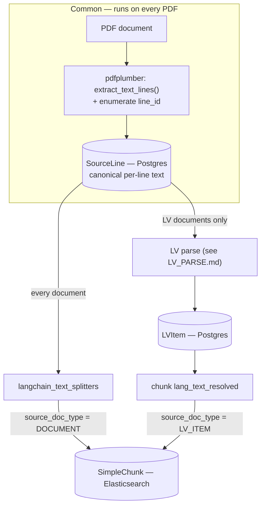

# Ingestion

Every PDF first goes through a **common extraction stage** that turns it into per-line text (`SourceLine`, in Postgres). From there the pipeline branches: _every_ document is simple-chunked into `SimpleChunk` (Elasticsearch), and _LV documents additionally_ go through the LV parse, which produces `LVItem` records (Postgres) that are then chunked. `SourceLine` is the canonical text store, which is what keeps the Elasticsearch index fully rebuildable.

Elasticsearch holds only `SimpleChunk`; `SourceLine` and `LVItem` live in Postgres. (See the Canonical Data Model for shapes.)

## Notes

- **The common stage runs on every PDF.** pdfplumber's `extract_text_lines()` (not `page.lines`, which is vector graphics) yields one record per visual line; you enumerate them into a global `line_id` and persist them as `SourceLine` rows. Because every document's verbatim text lives here, the Elasticsearch index is fully derivable — you can re-chunk or re-embed by replaying from `SourceLine` without re-touching the PDFs.
- **Simple strategy — every document.** The document text is split by `langchain_text_splitters` into `SimpleChunk`s with `source_doc_type = DOCUMENT`, `source_doc_field = body`. Prose documents stop here.
- **Parse strategy — LV documents only.** An LV document _also_ goes through the LV parse, producing `LVItem` rows in Postgres; their `lang_text_resolved` is then chunked into `SimpleChunk`s with `source_doc_type = LV_ITEM`. The parse is detailed in [LV_PARSE.md](./LV_PARSE.md).
- Both branches terminate in the single `SimpleChunk` index; the `source_doc_type` discriminator (with `source_doc_uuid`) is how a chunk resolves back to its `Document` or `LVItem` parent.
- (Other per-document artifacts — page `Thumbnail`s, `IngestJob` tracking — also run during ingestion but are out of scope for this diagram.)
