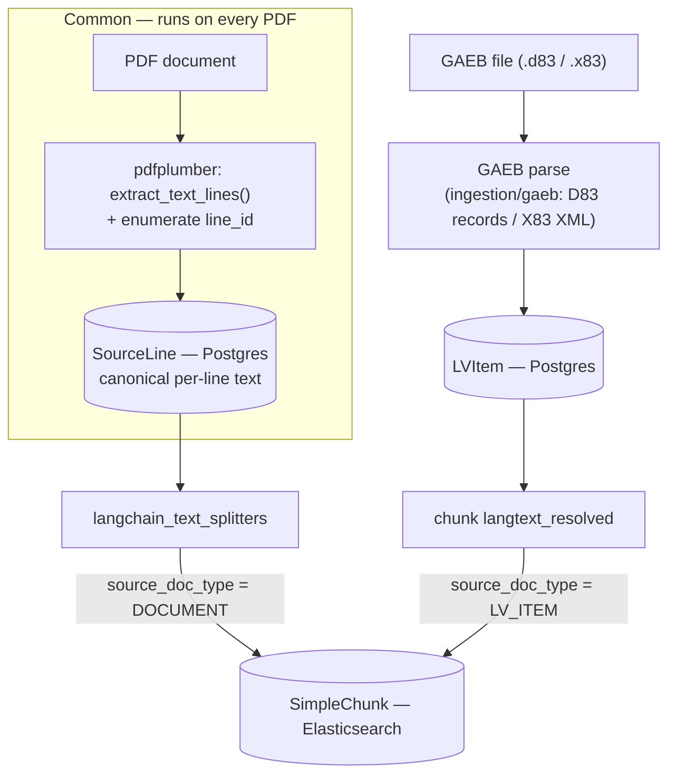

# Ingestion

Every PDF goes through a **common extraction stage** that turns it into per-line text (`SourceLine`, in Postgres) and is simple-chunked into `SimpleChunk` (Elasticsearch). That is the whole PDF story — including the LV print-layout PDF, which is just prose. `LVItem` records come exclusively from **GAEB files** (fixed-format `*.d83` or GAEB DA XML `*.x83`): a GAEB upload is the project's LV document by definition, parses deterministically (no LLM), and its items are chunked into `LV_ITEM` chunks. `SourceLine` is the canonical text store for PDFs, which is what keeps the Elasticsearch index fully rebuildable.

Elasticsearch holds only `SimpleChunk`; `SourceLine` and `LVItem` live in Postgres. (See the Canonical Data Model for shapes.)

## Notes

- **The common stage runs on every PDF.** pdfplumber's `extract_text_lines()` (not `page.lines`, which is vector graphics) yields one record per visual line; you enumerate them into a global `line_id` and persist them as `SourceLine` rows. Because every PDF's verbatim text lives here, the Elasticsearch index is fully derivable — you can re-chunk or re-embed by replaying from `SourceLine` without re-touching the PDFs.
- **Simple strategy — every PDF.** The document text is split by `langchain_text_splitters` into `SimpleChunk`s with `source_doc_type = DOCUMENT`, `source_doc_field = sourcelines.line_text`. All PDFs — prose and LV print layout alike — stop here.
- **LV items — GAEB files only.** A GAEB file (`.d83`/`.x83`) is the project's LV document by definition; `server/shared/services/ingestion/gaeb` parses it deterministically (D83: CP850 80-column records; X83: GAEB DA XML) into `LVItem` rows; their (`langtext_resolved` || `langtext`) is then chunked into `SimpleChunk`s with `source_doc_type = LV_ITEM`. The GAEB path skips thumbnails, `SourceLine`s, and `DOCUMENT` chunks entirely — the emitted `LVItem`s carry empty `source_lines`/pages. Hinweistexte (D83 Zeilenart 20, X83 `Remark`) are copied onto every following priced position in their scope, and textual back-references resolve into `linked_oz`/`langtext_resolved` with the same OZ-linking semantics throughout (`level`, `parent_oz`, `prev_oz`/`next_oz`).
- **A GAEB upload supersedes the project's LV.** Uploading a D83/X83 deletes the project's existing LV document first, which removes its LV items (Postgres cascade) and chunks (Elasticsearch archive) before the new ones are written. The one-LV-document-per-project invariant holds throughout.
- Both branches terminate in the single `SimpleChunk` index; the `source_doc_type` discriminator (with `source_doc_uuid`) is how a chunk resolves back to its `Document` or `LVItem` parent.
- **Re-ingestion archives prior chunks; it does not silently overwrite.** Before a source's new `SimpleChunk`s are written, all existing chunks for that source — matched on `(source_doc_uuid, source_doc_type)` — are moved to the `{elasticsearch_index}_archive` index (e.g. `roadbuilders_text_archive`) with an added `archived_at` (timestamptz), then the source is re-chunked fresh in the live index. Matching the whole source (not per `chunk_index`) means a re-ingest that yields fewer chunks leaves no stale high-index rows behind. This keeps the live index current and idempotent while preserving prior versions. Postgres rows upsert on their natural keys (`SourceLine` by `(document_uuid, line_id)`, `LVItem` by `(document_uuid, oz)` with `last_ingestion` bumped).
- (Other per-document artifacts — page `Thumbnail`s, `IngestJob` tracking — also run during ingestion but are out of scope for this diagram.)
- The LLM-based LV parse of PDF documents ([LV_PARSE.md](./LV_PARSE.md)) is no longer part of the pipeline; it remains available as a standalone harness (`python -m scripts.run_lv_extraction`) for experimentation.
