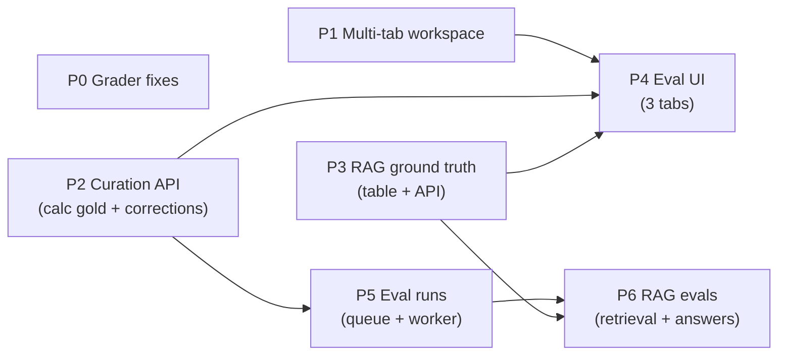

# LLM_EVAL_PLAN.md

Plan for the evaluation platform build-out: multi-tab workspace, gold-data curation UI, RAG ground
truth, and worker-driven eval runs. Branch: `llm-eval`. Design mockup:
<https://claude.ai/code/artifact/8d3a2384-1744-4853-a590-60367c3e6fd2>.

Builds on the merged ground-truth capture system (see EVAL_STATUS.md). Each phase is an
independently committable slice; sub-slices (a/b/c) are natural commit points inside a phase.

## Phase map

P0–P3 are mutually independent and can be built in any order. P4 wants P1 first (Arthur's
ordering: tabs before more eval UI) and needs P2+P3 for data. P5 is backend-only and can proceed
in parallel with P4. P6 last.

## Phase 0 — Grader fixes (S)

Small corrections to the existing offline grader before anything is built on top of it.

| Task | Where |
|---|---|
| Grade `bauverfahren_key` against gold as its own metric (`bauverfahren_accuracy`); gold already stores it, `grade.py` never compares it | `server/scripts/eval_calculator/grade.py`, `run.py` |
| Harden `run.py`: when a gold recipe no longer exists in the catalog, skip + warn instead of aborting the whole run | `server/scripts/eval_calculator/{run,capture}.py` |
| Verify `sql/09_ground_truth_capture.sql` is applied to the compose DB (manual `\d calculation_ground_truth`) | operational |

Done when: unit tests extended (`tests/unit/eval/test_grade.py`) and green; a run against a
project with one stale-recipe gold row completes with a warning.

Not in scope here (Arthur, manual): capturing the first real gold set at Gate B and authoring more
chat fixtures — the operational items from EVAL_STATUS §9.

## Phase 1 — Multi-tab workspace (M/L)

Goal: several conversations open at once; an EKT run paused at Gate B stays live while a second
conversation interrogates the documents. Findings from the code walk that shape the design:

- `WorkspaceView` deliberately remounts `WorkspaceViewInner` via `key={conversationId}` — all
  stream/interrupt-form/scroll state is component-local and dies on switch.
- `useWorkspaceConversation(conversationId, …)` is already fully parameterized by id — N instances
  work in parallel if kept mounted.
- Drafts (`ws:{id}`) and retrieval config (`byConversation[id]`) are already per-conversation and
  persisted — tabs get them for free.
- `store/ui.ts` has `activeStreamIds: Record<cid, boolean>` — written on stream start/end,
  currently read by nobody. It becomes the per-tab streaming indicator.
- A paused gate is reconstructable from server state (`derivePendingInterrupt` +
  `calculation_status === 'awaiting_input'`), so even a dropped tab recovers its gate.

### 1a — Tabs store + strip (commit)

- New `ui/src/store/tabs.ts` (Zustand, persisted): `openTabs: string[]`, `activeTab: string | null`,
  actions `openTab` (append if absent, activate), `closeTab` (activate neighbor or navigate home),
  `activateTab`. Cap open tabs (default 6, oldest-inactive evicted with confirm).
- Tab strip component in `ui/src/components/layout/` mounted in `AppShell.tsx`'s `<main>` column
  above `MainWindow`/`Outlet`. Tab = title (from list cache) + type glyph + close button +
  streaming dot (`activeStreamIds`) + paused-gate badge (`calculation_status`).
- URL stays the source of truth for the *active* tab: `/c/:id` navigation activates/opens a tab;
  tab click navigates. Sidebar `ConversationList` rows and all three "start" hooks
  (`useStartProjectChat`, `useStartKatalogChat`, `useRunCalculation`) open tabs instead of
  replacing the view. `/close` closes the tab; `/remove` closes it and deletes.

### 1b — Keep-mounted conversation panels (commit)

- Replace the `key={conversationId}` remount with a `TabHost` under the `/c/:id` route (or in
  `AppShell`) rendering one `WorkspaceViewInner` per open tab, each with a fixed `conversationId`
  prop; inactive panels hidden, not unmounted.
- Scroll position: `hidden`/`display:none` does not reliably preserve `scrollTop` — save it in
  `MessageList` on hide, restore on show (or keep stick-to-bottom as the default and only restore
  when unstuck).
- InterruptPanel form state now survives automatically (never unmounts).
- SSE streams keep flowing into hidden panels (today they're never aborted anyway — the buffer
  just used to die with the unmount). Verify a Gate-B interrupt arriving in a background tab
  shows the badge from 1a.
- `MainWindow` overlay stays a single global that covers the panel area; the tab strip remains
  visible above it (open main-window view ≠ losing your tabs).

Done when: EKT conversation paused at Gate B in tab 1; open a project chat in tab 2, run a RAG
question mid-stream, switch back and forth — no lost stream text, no lost gate form edits, drafts
intact; `tsc --noEmit` clean.

## Phase 2 — Curation API: calc gold + corrections (M)

All logic in `shared/services`, thin routes, per repo convention.

- **Repositories**: `GroundTruthRepository.delete(project_uuid, lv_item_uuid)`;
  `VariableCorrectionRepository.list_by_project(..., variable_name=None, reason=None)` +
  `summary_by_project` (grouped counts variable × reason).
- **Service** (`shared/services/ground_truth.py`, extend): curation ops with boundary validation —
  `leistung_key`/`bauverfahren_key` must exist in the catalog; gold variable names validated
  against the recipe worklist on upsert. **Stale detection**: diff each gold row's variable names
  against the current recipe worklist (katalog service), return `stale: bool` + the missing/extra
  names in the list response. `created_by_user_id` from the authenticated user.
- **API** (`server/api/routes/ground_truth.py`, new):
  - `GET /projects/{uuid}/ground-truth` (list + stale info)
  - `PUT /projects/{uuid}/ground-truth/{lv_item_uuid}` (upsert; also serves "reconfirm" which
    re-stamps `updated_at`)
  - `DELETE /projects/{uuid}/ground-truth/{lv_item_uuid}`
  - `GET /projects/{uuid}/corrections?variable_name=&reason=` (read-only)
  - `GET /projects/{uuid}/corrections/summary`
  - No write endpoints for corrections — they enter only via the EKT Gate-B flow.
- **Models**: API schemas in `shared/models/ground_truth.py`; `npm run gen:types`.

Done when: unit tests for the service validation/stale logic; integration tests for routes + new
repo methods; types regenerated.

## Phase 3 — RAG ground truth (M)

The reference-question store (replaces the sample `eval/truth.json` as the source of truth).

- **DDL** `sql/10_rag_ground_truth.sql`; table `rag_ground_truth` on the domain MetaData:
  `rag_ground_truth_uuid PK`, `project_uuid FK`, `question text`, `gold_answer text`,
  `refs jsonb` (list of `{document_uuid, page}`), `question_type` (StrEnum: `lookup`,
  `aggregation`, `multi_hop`, `constraint_surfacing`, `cross_doc_conditional`), `category`
  (`kalkulator` | `bauleiter`), `created_by_user_id`, timestamps.
- **Model** (`shared/models/rag_ground_truth.py`), **repository** (CRUD + `list_by_project`),
  **service** (`shared/services/rag_ground_truth.py`): validate refs against the project's
  ingested documents (document exists, page within `page_count` if available). A question without
  refs is legal but flagged (`refs_missing`) — it counts only toward answer grading, not
  retrieval metrics.
- **API** `server/api/routes/rag_ground_truth.py`: project-scoped CRUD.
- Seed script (optional, S): import the plausible entries from `eval/questions.csv` as a starting
  set for the demo project, answers to be reviewed by hand.

Deferred: Gate-B-style capture from project chat ("Als Referenzfrage speichern" on a corrected
answer). Parked until the curation UI proves the shape.

Done when: CRUD round-trips in integration tests; ref validation unit-tested; types regenerated.

## Phase 4 — Eval UI (M/L) — per the mockup

Route `/p/:projectUuid/eval` (new project-scoped route in `App.tsx`), entry from the project
details view. Tailwind + Catalyst (`components/ui/`: table, badge, button, select, combobox,
fieldset, input, textarea, dialog, switch, pagination). Server-state hooks one-file-per-resource:
`ui/src/api/groundTruth.ts`, `variableCorrections.ts`, `ragGroundTruth.ts` (+ query-key
factories). View code in `ui/src/views/eval/`.

- **4a — Kalkulation-Gold tab (commit)**: stat tiles, gold table (OZ, Leistung, BV, variable
  count, source-conversation link, updated, stale badge), expandable row → variable editor
  (wert/einheit/art/quelle, hitl-override marker, add-variable combobox restricted to the recipe
  worklist), delete with `dialog.tsx` confirm, "Gold neu bestätigen" on stale rows.
  "Position hinzufügen" dialog (LV-item picker → catalog keys → worklist form) is a **second
  slice** inside 4a — build edit/delete/reconfirm first.
- **4b — Korrekturen tab (commit)**: read-only banner, stacked-bar error analysis (model error /
  data gap / Ermessen / other, from the summary endpoint), filters (variable, reason, period),
  "Nur Modellfehler" toggle, corrections table with proposal→final and conversation links.
- **4c — RAG-Fragen tab (commit)**: question table (type chip, answer preview, ref chips,
  refs-missing badge), editor (question/answer textareas, type+category selects, refs editor with
  document combobox + page input), add/delete with confirm.

Done when: all three tabs function against the live API; `tsc --noEmit` clean; responsive (tabs
scroll, tables scroll in cards, editor grid collapses).

## Phase 5 — Eval runs: queue + worker + launch UI (L)

Clone the `ingest_jobs` mechanics (SKIP LOCKED claim, lease + heartbeat, retry-then-park, events
table). Postgres is the queue — no Redis.

- **5a — Service-ify the graders (commit)**: move the run logic from
  `server/scripts/eval_calculator/{run,run_chat,capture}.py` into
  `shared/services/eval/` (e.g. `calculator_runner.py`, `chat_runner.py`; `grade*.py` move as
  pure modules). The CLI scripts become thin wrappers (same flags, same output files) so local
  runs keep working. Unit tests move/extend accordingly.
- **5b — Queue tables + worker (commit)**: `sql/11_eval_runs.sql` — `eval_runs`
  (`kind` StrEnum: `calculator_gold` | `chat_values` | `rag_retrieval` | `rag_answers`,
  `project_uuid` nullable, `params jsonb`, status/lease/attempts columns mirroring `ingest_jobs`,
  `summary jsonb`, `prompt_versions jsonb`, `created_by_user_id`), `eval_run_events`
  (progress messages), `eval_results` (one row per position/fixture/question for UI drill-down —
  replaces git-ignored JSONL as the system of record; CLI still writes files).
  Repos + `shared/services/eval/run_service.py` (enqueue, claim, heartbeat, record event/result,
  finalize). Worker: second asyncio poll loop in `worker/main.py` sharing the built clients;
  promotable to its own container later without code change.
- **5c — API + UI (commit)**: `server/api/routes/eval_runs.py` — `POST /eval-runs`,
  `GET /eval-runs?project=`, `GET /eval-runs/{id}` (+events, +results). UI: "Evaluation starten"
  dialog (kind + params), runs list with status/progress (poll events; SSE only if polling
  chafes), summary panel keyed to prompt versions. Lives as a fourth tab or a section on the eval
  view — decide during 4a layout work.

Done when: an eval run enqueued from the UI is claimed by the worker, emits progress events,
lands summary + per-position results in Postgres, and survives a worker kill mid-run (lease
reclaim, attempts+1).

## Phase 6 — RAG evals (M)

Two new run kinds executing inside the Phase-5 harness, consuming Phase-3 gold.

- **6a — Retrieval grader** (`rag_retrieval`, deterministic, no judge): for each question with
  refs, run the retriever only; match retrieved chunks to gold `(document, page)` refs; report
  recall@k, MRR, nDCG (aggregate + per question_type). Params: k, retrieval knob overrides — this
  is the empirical tuning loop for the RAG config.
- **6b — Answer grader** (`rag_answers`): run the full chat pipeline per question; grade
  correctness deterministically where the gold answer is crisp (numbers, classes, dates —
  tolerance compare), else LLM-judge; faithfulness judge (claim decomposition vs *retrieved*
  context) as a versioned prompt through the prompts system so results stay keyed to prompt
  versions. Reference-free faithfulness + gold-based correctness + 6a retrieval hit → failure
  triage (retrieval miss vs hallucination vs gold/reasoning error).

Done when: both kinds run end-to-end from the UI against the demo project's question set;
baseline summaries recorded.

## Parking lot (explicitly out of scope)

- `EKT_OUTPUT_NARRATE` faithfulness judge; `AGGREGATE_LV_MEMBERSHIP` grader.
- Phoenix span annotations for eval scores; CI regression gate; confidence calibration.
- Cross-project aggregate reporting.
- AA selection prompt + eval (TODO comment placed in `calculator/graph.py` `bind_resources`).
- RAG-question capture from project chat.

## Open decisions (small, decide when reached)

- Tab cap + eviction UX (default 6?).
- Eval view placement: standalone route `/p/:id/eval` (planned) vs. main-window view — standalone
  planned because main-window overlay is a singleton that replaces the outlet.
- `eval_results` granularity for chat fixtures (per fixture vs per assignment).
- Whether `run.py`'s file output stays long-term once results live in Postgres.
