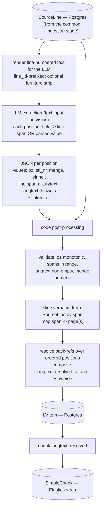

# LV Parse

> **Status: retired from the pipeline.** Production LV items now come exclusively from GAEB
> files (D83/X83, see `server/shared/services/ingestion/gaeb` and [INGESTION](./INGESTION.md));
> LV PDFs get only the common simple chunking. The LLM parse described here remains available
> as a standalone harness (`python -m scripts.run_lv_extraction`) for experimentation.

The detail behind the former LV-PDF branch in [INGESTION](./INGESTION.md): how the `SourceLine` rows for an LV document become `LVItem` records (and, downstream, `SimpleChunk`s). The PDF→`SourceLine` extraction is no longer described here — it's the common ingestion stage that runs on every PDF; this document starts from the `SourceLine` rows it produces.

## Summary

Given the `SourceLine` rows for an LV document, this stage produces one `LVItem` per position (OZ). Its guiding principle is a strict division of labor: **deterministic code owns the binding text, the LLM owns only segmentation.** The LLM reads a line-numbered rendering of the `SourceLine` text and says which lines belong to which position and field — but it never reproduces the contractual `langtext` and never emits coordinates. Code then slices the verbatim text out of `SourceLine` by line span, resolves "wie in voriger Position" back-references into `langtext_resolved`, and attaches governing Hinweise.

## Steps

1. **SourceLine (input)** — produced by the common ingestion stage; one row per visual line with `line_id`, `page`, `bbox`, `line_text`. This is the verbatim source of truth the rest of the stage slices from.
2. **Render line-numbered text** — concatenate the document's `SourceLine` rows, each prefixed with its `line_id`, into the plain text the LLM will read. Strip repeating page furniture (headers/footers) from this rendering — `SourceLine` itself stays complete. This is the only thing the LLM sees.
3. **LLM extraction (text, no vision)** — the model returns each position with every field mapped to a line span (prose) or a parsed value (short header-line tokens). Segmentation only — no reproduced text, no coordinates.
4. **JSON per position** — _values_ for `oz`, `stl_nr`, `menge`, `einheit`; _line spans_ for `kurztext`, `langtext`, `hinweis`; plus `linked_oz` when the position reads "wie in voriger Position."
5. **Code post-processing** — consumes the JSON together with the `SourceLine` rows. Everything from here is deterministic.
6. **Validate** — OZ monotonic, line spans in range and non-overlapping, `langtext` non-empty, `menge` numeric, `stl_nr` well-formed. Fail loudly or route low-confidence positions to review.
7. **Slice verbatim + map to pages** — cut the exact text out of `SourceLine` by line span, and resolve each span to its page(s).
8. **Resolve back-refs + attach Hinweise** — for "wie in voriger Position" items, compose `langtext_resolved` (predecessor body + delta, recursively for chains) while keeping `langtext` verbatim; attach each Hinweis to the OZ or Titel it names.
9. **LVItem (Postgres)** — emit one record per position: `oz`, `kurztext`, `langtext`, `langtext_resolved`, `menge`, `einheit`, `positionstyp`, `level`, `stl_nr`, `hinweis`, and the `linked_oz` / `prev_oz` / `next_oz` / `parent_oz` links.
10. **Chunk → SimpleChunk (Elasticsearch)** — chunk (`langtext_resolved` || `langtext`) (sub-splitting long positions) into `SimpleChunk`s with `source_doc_type = LV_ITEM`, carrying the denormalized `oz` and `stl_nr`.
