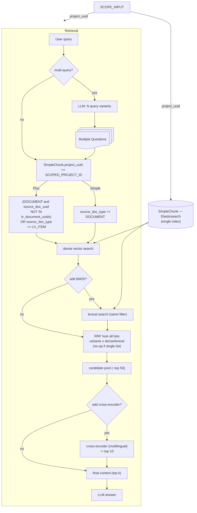

# Retrieval

A retrieval will ALWAYS have a project_uuid. The user MUST be in a project conversation in order to use Retrieval.

A RAG retrieval has two modalities:

- Simple: a simple chunking of documents based on a simple Langchain Text Splitter
- Plus: the key LV document is parsed and then stored structurally as LV Items and then vector search is on the items specifically.

The retrieval also has some options:

- Single Query: What the user entered as a query.
- Multi Query: use an LLM to generate several variants of the query.

HyDE was rejected because this option is not good for legally binding tender documents. It actually may increase the chance that non-relevant data (no matter how semantically similar) is pulled, clouding the results.

## Scopes

Both apply `project_uuid == {project_uuid}` first; they differ only in the `source_doc_type` predicate added on top:

- **Simple** — `source_doc_type == DOCUMENT`. Searches every document's simple chunks, including the LV's own whole-document chunks; the parsed `LV_ITEM` chunks are not searched. This is the baseline.
- **Plus** — `(source_doc_type == DOCUMENT AND source_doc_uuid NOT IN {lv_document_uuids}) OR source_doc_type == LV_ITEM`. Prose stays as simple chunks; the LV is represented by its parsed items; the LV document's _own_ simple chunks are excluded so the LV content isn't counted twice. This is the "structure for the LV, simple for prose" configuration.

## Notes

- **Building the Plus filter needs a Postgres lookup first.** Resolve the project's LV document uuids (`Document.document_type == LV_DOCUMENT`) and pass them as the exclusion set. With one LV per project it's `source_doc_uuid != {lv_document_uuid}`; with several it's `NOT IN {…}`.
- **RRF is triggered by multi-query OR BM25**, not BM25 alone — either produces more than one ranked list, and the fusion stage reconciles them all. With a single list it is a no-op pass-through.
- **Cross-encoder is the only post-retrieval stage**; use a multilingual reranker on German LV/ZTV text.
