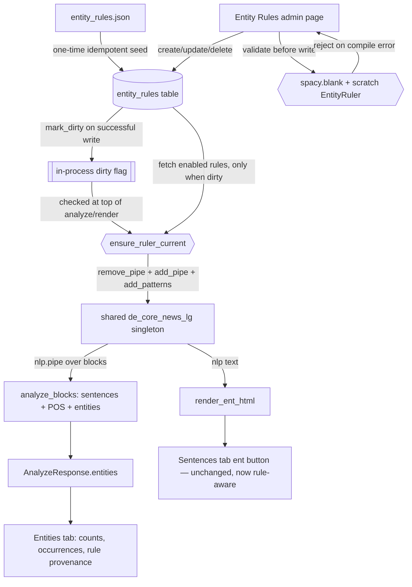

# Design: Entity Ruler NER

## Context

The prior change (`nlp-analysis-modal`) added a shared, lazily-loaded `de_core_news_lg` spaCy singleton used by `analysis.py` (sentences/POS) and `render.py` (dep/ent displacy). Its stock NER covers only PER/LOC/ORG/MISC, trained on news text, and mislabels or ignores nearly all Baubeschreibung-domain vocabulary — verified against real sentences (`Asphaltbeton AC` → LOC; `Bauablaufplan` → nothing).

Arthur authored `server/shared/services/nlp/entity_rules.json`: 240 spaCy EntityRuler patterns across 14 labels (`BAUSTOFF`, `AUSBAUSTOFF`, `BAU_VORGAENGE`, `FGSV_REGELWERK`, `DIN_NORM`, `BAU_NORM`, `EINHEIT`, …), mixing literal phrase strings (146) and token-attribute patterns (94, using `ORTH`/`TEXT.REGEX`/`LEMMA`/`OP`). Verified: all 240 compile cleanly against a blank spaCy pipeline, and running the full set against real sentences produces correct overrides of the stock model's wrong guesses, with no internal overlaps between the authored patterns themselves (each label targets distinct lexical roots — confirmed by inspection and test sentences).

## Goals / Non-Goals

**Goals:**

- Store the ruleset in Postgres, editable through a UI, without redeploying to change a pattern.
- Wire the ruleset into the existing shared spaCy singleton so both the ent render and a new aggregated view benefit automatically.
- Validate every write against spaCy's own pattern compiler — reject bad JSON before it reaches the running pipeline.
- Surface rule-derived vs. stock-model entities distinctly, so mispredictions (requirement 3) are visible, not hidden.

**Non-Goals:**

- Generating patterns from Katalog rows (`katalog_baustoffe.name`, etc.) — a natural future increment, not this change.
- SpanRuler-based multi-label ambiguity/candidate surfacing — unneeded; the authored rules don't overlap each other. `EntityRuler`'s built-in longest-match resolution is sufficient. If overlaps appear as the ruleset grows, revisit then.
- Multi-process cache coherency for the ruler — the API runs as a single uvicorn process (see Dockerfile `CMD`); an in-process dirty flag is sufficient, consistent with the existing `_nlp`/`_converter` singletons.

## Pipeline

## Decisions

**D1 — JSONB pattern column, not a modeled schema.** spaCy's token pattern DSL is heterogeneous by design (any of `ORTH`/`TEXT`/`LOWER`/`LEMMA`/`POS`/`MORPH`/… with `OP`, `IN`, `REGEX` modifiers, arbitrary nesting) and a pattern may be a bare string (phrase match) or a list of such dicts. Modeling this fully in Pydantic/SQL would reimplement spaCy's own schema for no safety benefit. spaCy is the validator at this boundary (D5); Python types it as `str | list[dict[str, Any]]`, the one honest representation of a genuinely-arbitrary external contract.

**D2 — `label` and `pattern_id` are free text, not enums.** Unlike `BlockType`/`RenderStyle` (closed, code-defined vocabularies), entity labels are domain taxonomy Arthur curates and grows through the admin UI — an enum would need a code change per new label, defeating the point of an editable ruleset. The API exposes `GET /entity-rules/labels` (distinct existing labels) purely so the UI can offer autocomplete, not to enforce a closed set.

**D3 — In-process dirty flag, no DB-backed version row.** A `katalog_stand`-style singleton version table would be the idiomatic choice if multiple API processes needed to observe each other's writes, but this API runs single-process (Dockerfile: bare `uvicorn`, no `--workers`). A module-level flag flipped by any successful mutation, checked (cheaply) at the top of `analyze`/`render`, is sufficient and avoids a table whose only job would be surviving a restart that already forces a fresh (dirty-by-default) process anyway.

**D4 — Rebuild by remove+re-add, not incremental patch.** `EntityRuler.add_patterns` is additive; toggling a rule off or editing a pattern requires the pipe's full pattern set to change, not append to it. On dirty, `nlp.remove_pipe("entity_ruler")` (if present) + `nlp.add_pipe(...)` + `add_patterns(enabled_rules)` — cheap (240 patterns compile in under a millisecond, measured) and always correct, unlike tracking incremental diffs.

**D5 — `overwrite_ents=True`.** The ruler runs after the stock `ner` in the pipeline; without this flag, the ruler would only fill gaps the stock model left untagged, keeping wrong guesses like `Asphaltbeton AC → LOC`. With it, ruler matches replace overlapping stock entities — domain rules are ground truth over generic guesses in this corpus. Where the ruler has no rule (`Bordstein`), the stock guess still shows through, and the Entities tab's rule-provenance column makes that visible rather than silently "fixing" it.

**D6 — Entities computed inside the existing `analyze_blocks` pass, not a separate endpoint.** The function already runs `nlp.pipe` over included blocks for sentences/POS; `doc.ents` (and per-sentence attribution via `Span` containment) is nearly free there. `AnalyzeResponse` grows an `entities` field; no new endpoint, no second parse of the same text.

**D7 — Validation via a scratch blank pipeline, not the live model.** `spacy.blank("de")` + a throwaway `entity_ruler` compiles just the candidate pattern (fast, no model weights) to catch spaCy `MatchPatternError`/`ValueError` before writing — never mutates the live singleton to test a pattern.

**D8 — Admin page as a MainWindow kind, not a Dialog.** Rules are global configuration, not scoped to one document — matching how Prompts and Katalog are managed (persistent `MainWindow` panel opened from a sidebar Command), not how the per-document NLP Analysis modal (a `Dialog`) works.

## Risks / Trade-offs

- [A bad pattern reaches the DB despite validation (e.g. spaCy accepts it standalone but it behaves pathologically combined with 239 others)] → the dirty-rebuild is defensive: if `add_patterns` throws when rebuilding the *full* set, the ruler keeps its last-good compiled state (rebuild happens into a fresh pipe before swapping) — mitigation documented, not fully implemented as a rollback in v1; a bad full-set rebuild currently surfaces as a 500 on the next analyze call. Flagged for a v1.1 fix (keep old pipe until new one compiles clean) if it proves to be a real occurrence.
- [`overwrite_ents=True` silently discards a correct stock-model entity where a rule over-matches] → the Entities tab shows rule provenance per hit, so an unexpectedly-labeled span is inspectable; iterating the ruleset from observed mispredictions is the intended workflow, not a one-shot perfect ruleset.
- [Single-process dirty flag assumption breaks if the API ever scales to multiple workers] → documented in Non-Goals; would need the `katalog_stand`-style DB version row at that point, a contained follow-up.

## Migration Plan

1. Create `entity_rules` table (via `bootstrap_tables.py`, no SQL migration needed — a fresh `create_all`-visible table).
2. Run `server/scripts/seed_entity_rules.py` once to import `entity_rules.json` (idempotent — safe to re-run).
3. Deploy the pipeline/API/UI changes together (the ruler pipe is additive to the existing singleton; no behavior change until rules exist, at which point NER quality on Baubeschreibungen improves immediately).
