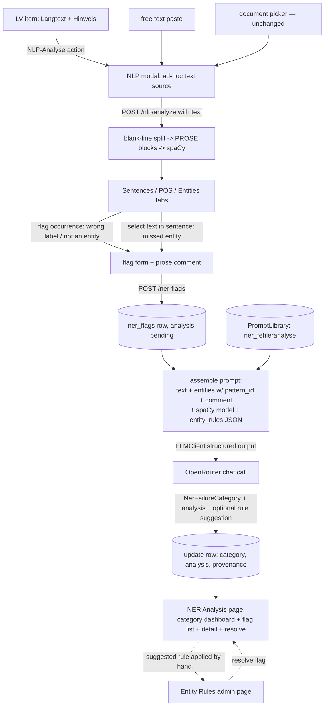

# Design: NER Error Investigation

## Context

The archived changes `nlp-analysis-modal` and `entity-ruler-ner` built: the reflow/analysis pipeline over Baubeschreibungen, the four-tab NLP modal, the DB-backed EntityRuler (`entity_rules` table, `entity_ruler.py` with `mark_dirty`/`ensure_ruler_current`), and entity extraction with provenance (`EntityOccurrence.pattern_id` present for rule hits, `None` for stock-model guesses). What's missing for requirement 3: LV-register text can't be analyzed (analyze is document-bound), and observed mispredictions evaporate — there is no capture, no analysis, no aggregation.

The corpus facts driving the LV part: all 1,405 `lv_items` have `langtext`, 913 have `hinweis`, 48 have `langtext_resolved` (STL references expanded). The register is telegraphic (`Asphaltbefestigung geradlinig trennen. | im Anbaubereich quer zur Fahrbahnachse...`) — short, verb-final fragments where news-trained NER degrades most, which is precisely the investigation material.

The app has established plumbing this change rides on: `LLMClient` (OpenRouter transport, Pydantic structured output, automatic `prompt_execution_log` + `openrouter_usage` + Phoenix tracing), the PromptLibrary (seeded versioned prompts, `ADDING_A_PROMPT_TYPE.md` checklist), and the MainWindow admin-page pattern (Prompts, Katalog, Entity Rules).

## Goals / Non-Goals

**Goals:**

- Analyze ad-hoc text (LV Langtext/Hinweis, pasted text) with the full existing pipeline output (sentences, POS, entities, renders).
- Capture all three misprediction shapes: wrong label, phantom entity (not an entity), missed entity (text selection).
- One LLM analysis per flag, categorized against a closed failure taxonomy, persisted with full provenance (spaCy model, prompt version, LLM model, flag-time entity snapshot).
- A dashboard whose category counts read as requirement-3 findings, with drill-down to each analyzed case and a resolve workflow.

**Non-Goals:**

- Auto-applying LLM-suggested rules (display only; the Entity Rules page is the write path).
- Re-running analyses when the ruleset or prompt changes (flags are point-in-time records; provenance columns make staleness visible).
- Flag quality control (dedup detection, multi-user review) — single-user learning tool.

## Flow

## Decisions

**D1 — Ad-hoc analysis reuses `AnalyzeRequest`, not a new endpoint.** `AnalyzeRequest` gains an optional `text` field, mutually exclusive with `document_uuid` (schema-validated: exactly one). The text path splits on blank lines into PROSE blocks (no Docling, no reflow — LV text has no layout geometry) and flows into the same `analyze_blocks`. One endpoint, one response shape; the modal's tabs work unchanged. Alternative — separate `/nlp/analyze-text` — rejected: two endpoints returning the same shape invite drift.

**D2 — Flag rows snapshot their context.** `ner_flags` stores the analyzed text in full (`source_text`), the sentence, the span (text + char offsets in the sentence), the label involved, and the flag-time entity list as JSONB. Rationale: ad-hoc text has no stable server-side identity to reference (nothing like `document_uuid`), and even for documents, later ruleset edits change what an analysis returns — the flag must remain interpretable as a point-in-time record. Source linkage (`lv_item_uuid`/`document_uuid`, both nullable) is provenance, not the data.

**D3 — Failure taxonomy is a closed `StrEnum`, assigned by the LLM via structured output.** `NerFailureCategory`: `REGISTER_MISMATCH` (news-trained model vs telegram/technical register), `MISSING_RULE` (no rule covers the vocabulary), `RULE_ERROR` (an existing rule fired wrongly or too broadly), `TOKENIZATION` (tokenizer artifact, e.g. `13108-1.`), `MODEL_LIMITATION` (statistical NER wrong guess outside its competence), `AMBIGUITY` (genuinely ambiguous even for a domain expert), `OTHER`. The LLM must pick one — enforced by the existing `LLMClient` structured-output path (Pydantic `output_model`), which the app already uses for every extraction prompt. A closed enum is what makes the dashboard aggregation meaningful; free-text categories would fragment. Mirrors the `VariableCorrectionReason` precedent.

**D4 — Analysis runs synchronously inside flag creation.** `POST /ner-flags` persists the flag, assembles the prompt, calls the LLM, updates the row, returns the completed record. One LLM call is seconds; the UI shows a pending state on the button. Alternative — enqueue to the worker — rejected: no queue semantics needed for a single interactive call, and the eval-queue precedent (Postgres queue + worker) exists for when batch re-analysis ever becomes real. If the LLM call fails, the flag row survives with `analysis` null and the API returns it with the error noted — the flag (human observation) is the valuable part; analysis can be retried via `POST /ner-flags/{uuid}/analyze`.

**D5 — Prompt is a seeded PromptLibrary entry: `PromptType.NER_FEHLERANALYSE = "ner_fehleranalyse"`.** Follows `ADDING_A_PROMPT_TYPE.md` end-to-end (enum member, `.prompt` file with matching stem, load site via `get_latest`, SQL migration widening both `prompt_type` CHECK constraints, lock tests, TS regeneration, UI lists). The prompt template carries placeholders for: analyzed text, entity list with labels + `pattern_id` (or "statistical model"), flag kind + flagged span + user comment, spaCy model name/version, and the full enabled `entity_rules` as JSON. Editable in the Prompts UI like every other prompt — Arthur's explicit requirement.

**D6 — Rule suggestions are advisory output, not writes.** The structured response includes `suggested_rule: {label, pattern, pattern_id} | None`. The dashboard detail view renders it as copyable JSON next to a hint pointing at the Entity Rules page. Auto-creating rules from LLM output would put an LLM write-path into a user-curated ruleset — rejected for v1; the human hop is the review step.

**D7 — Resolve is a status flip with a note.** `NerFlagStatus`: `OPEN` / `RESOLVED`, plus `resolved_note` text ("added rule baustoff_bordstein"). No deeper lifecycle. The dashboard counts both overall and open-only, so "7 missing rules (5 since resolved)" is expressible.

**D8 — Dashboard is a MainWindow page, flag capture lives in the modal.** Capture belongs where the evidence is visible (Entities tab rows: flag button; Sentences tab: text-selection flag for misses). Browsing/aggregation is global, cross-document — a MainWindow kind (`ner_analysis`) beside Prompts/Entity Rules, opened from the sidebar. Same split as entity rules (edit globally, observe locally).

## Risks / Trade-offs

- [LLM misassigns categories, corrupting the dashboard story] → the detail view shows the full analysis next to the category; a category override field on the flag (human wins over LLM) is included in v1 — the dashboard counts the effective (overridden-or-LLM) category.
- [~20k-token prompt per flag adds cost] → single-user, interactive-frequency; logged in `openrouter_usage` like everything else. If the ruleset grows 10x, filter the rules to the flagged label's neighborhood — noted as a future lever, not built.
- [Flag-time entity snapshot goes stale as rules improve] → intended: flags are historical evidence. Provenance columns (spaCy model, prompt version, LLM model, flag time) make the vintage explicit in the detail view.
- [Text selection UI for missed entities is finicky (selection spanning sentences, whitespace)] → constrain selection to within one sentence row; normalize/trim; reject cross-sentence selections with a hint.

## Migration Plan

1. New table via `bootstrap_tables.py` (fresh `create_all` table, no data migration).
2. `sql/NN_*.sql` migration widening the two `prompt_type` CHECK constraints for `ner_fehleranalyse` (existing DBs), then seed the prompt.
3. Deploy backend + UI together; no behavior change until the first flag is created.
