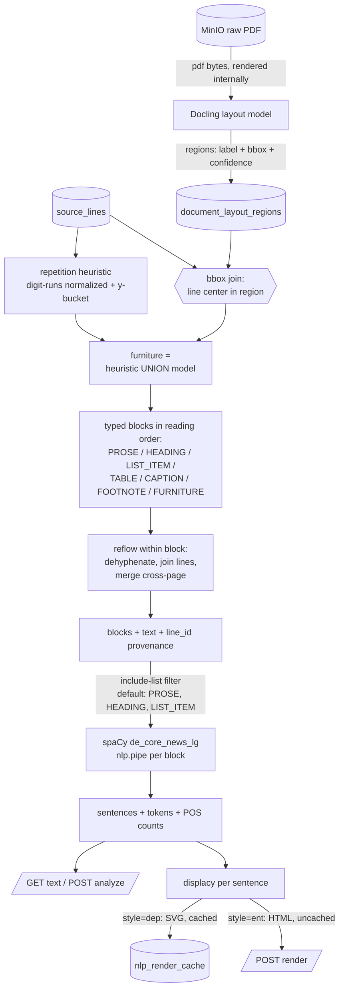

# Design: NLP Analysis Modal

## Context

`source_lines` holds every visual line of a document (`page`, `bbox`, `line_text`, gap-free `line_id`) as extracted by `pdftotext -bbox-layout` (see `server/shared/services/ingestion/extraction.py`; poppler renders AcroForm field appearances — the reason for this extractor and why it stays authoritative for text). Lines are layout units, not linguistic units: sentences span lines and pages, German justification hyphenates words across lines, letterheads/footers repeat on every page, and tables shred into cell fragments.

The layout spike (`nlp-playground/layout-spike/layout_spike.ipynb`, 4 Baubeschreibungen from 3 template families) established:

- Repetition heuristic and layout model have *complementary* furniture failure modes: the heuristic is consistent on repeated letterheads (B 246a: 90/90 vs Docling 40/90) but blind to non-digit variation (Brücke Nr. 6 roman-numeral front matter `Seite I/II` — models 100%, heuristic 0%). Union wins.
- Even pure Baubeschreibungen contain 3–6 small tables whose fragments must not reach the sentence splitter.
- Docling (MIT) beats YOLO-DocLayNet (AGPL via ultralytics) on license, label richness (caption, footnote, checkbox state), and reading order. ~1–2 s/page CPU after one-time model load; cacheable forever since PDFs are immutable.

spaCy backbone `de_core_news_lg` was chosen over `de_dep_news_trf` (no NER component, weak on composita) and over flair/GLiNER (rejected; NER will later be EntityRuler fed from the Katalog store).

## Goals / Non-Goals

**Goals:**

- Reflow any PROSE_DOCUMENT's `source_lines` into clean, typed, ordered blocks suitable for spaCy, with provenance from every block to `line_id` ranges.
- Serve sentence segmentation, POS statistics, and per-sentence displacy renders over HTTP.
- Three-tab modal for exploring text, sentences, and POS distribution — a learning instrument, so intermediate states (original lines vs reflowed, excluded blocks) stay inspectable.
- Block-type inclusion configurable per analysis request, defaulted sensibly, toggleable in the UI.

**Non-Goals:**

- NER (EntityRuler + Katalog integration is the next change; the `ent` render uses spaCy's stock NER as a placeholder).
- Table content extraction / table-heavy appendix documents (Baustoffverzeichnis class).
- Editing or persisting reflowed text as a new document artifact.
- Multi-language support (German only; corpus is German).

## Pipeline

## Decisions

**D1 — Hybrid layout: pdftotext text + Docling structure.** Text always comes from `source_lines` (AcroForm-capable, already persisted, `line_id` is the provenance backbone shared with LV extraction). Docling contributes only *structure*: regions labeled by its layout model, joined to lines by bbox center containment. Alternative — Docling end-to-end (own text extraction) — rejected: loses AcroForm text, breaks `line_id` provenance, duplicates ingestion.

**D2 — Furniture = repetition heuristic ∪ model labels.** Spike evidence shows neither alone suffices. A line is furniture if the heuristic flags it (normalized text + y-bucket repeating on ≥50% of pages, digit *runs* collapsed) or its center falls in a `page_header`/`page_footer` region. Excluded from all analysis but visible (dimmed) in the modal's original-lines view.

**D3 — Block-type inclusion is request-level config, not persisted settings.** `POST /nlp/analyze` takes `include_blocks: list[BlockType]`, defaulting to `[PROSE, HEADING, LIST_ITEM]`. Rationale: headings and list items are content-bearing and entity-rich (Hauptbauleistungen lists); `TABLE` fragments would poison sentence segmentation, so tables are excluded by default but selectable — turning them on and watching the sentence view degrade is itself the learning exercise. `CAPTION`/`FOOTNOTE` default off (register noise) but selectable. `FURNITURE` is never analyzable. The default lives as one module-level constant; the modal renders checkboxes from the `BlockType` enum. Alternative — per-project persisted config — rejected: premature; this is an exploration tool.

**D4 — Two cache tables, both content-addressed.** `document_layout_regions` (document_uuid PK-ish, regions JSON, docling model version) — PDFs are immutable, so layout inference runs once per document; version column invalidates on model upgrade. `nlp_render_cache` (key = sha256(spacy model name + version + style + sentence text), markup TEXT) — only `dep`/SVG renders are cached; `ent`/HTML is regenerated per request (cheap once the Doc exists, and its output will change when EntityRuler lands). Alternative — MinIO objects — rejected: rows are small text, Postgres keeps them transactional and queryable.

**D5 — Lazy model loading, worker-friendly.** spaCy and Docling models load on first use behind module-level singletons. Layout inference for an uncached document can take ~30 s (15+ pages); the analyze endpoint triggers it synchronously for now (spike-verified timings; documents are ≤73 pages) — if that proves unacceptable in the modal, promotion to an ingest-style worker job is the escape hatch, not a redesign.

**D6 — Reflow rules (German).** Within a block, join lines with spaces; line-end `-` + lowercase next → drop hyphen (justification break); line-end `-` + uppercase next → keep hyphen, join (compound like `SRT-Pendel`). Cross-page block merge when a page's last content block ends without terminal punctuation (or with a hyphen) and the next page's first block has the same type — no lowercase test on the continuation, because German capitalizes nouns and mid-sentence continuations regularly start uppercase. Paragraph boundaries inside a region: vertical gap > 0.8 × median line pitch (per-document adaptive).

**D7 — Renders.** `dep`: displacy SVG per sentence, cached (D4), rendered from the block's Doc. `ent`: displacy HTML rendered natively from the Doc — EntityRuler writes into `doc.ents`, so its output flows through this path unchanged when it lands. Both delivered as strings; UI injects via `dangerouslySetInnerHTML` inside a scoped wrapper with `overflow-x: auto`.

## Risks / Trade-offs

- [Docling misclassifies a prose block as table → silently dropped from analysis] → modal's original-lines toggle shows excluded blocks dimmed with their type; block-type filter makes the exclusion visible and reversible per request.
- [Docling adds ~1 GB image weight + torch to the server image] → models lazy-load; docs deploy note; acceptable for a single-user learning deployment.
- [Synchronous first-run layout inference blocks the analyze request ~30 s] → per-document cache makes it once-ever; UI shows a progress state; worker-job promotion documented as follow-up if needed.
- [Dehyphenation heuristic wrong on line-broken coordinations (`Zu- und Abgang`)] → rare (spike found none at line ends); wrong joins surface as unknown tokens in the POS click-through.
- [spaCy model upgrade silently changes cached dep renders] → cache key includes model name + version (D4).

## Open Questions

- None blocking. Parked for later changes: EntityRuler ambiguity signaling (SpanGroups vs custom attribute), table-document handling, whether `ent` whole-text view moves to tab 1.
